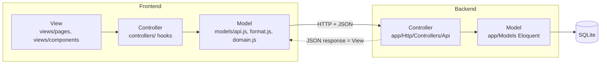
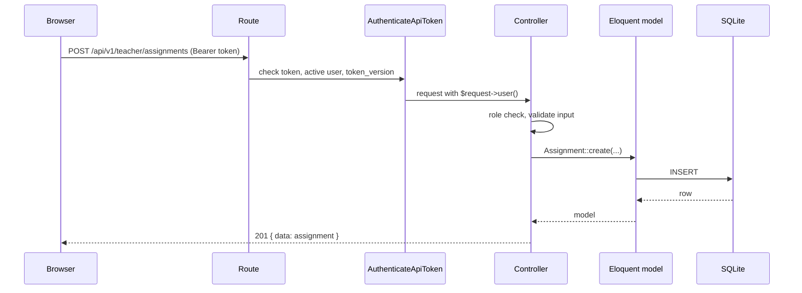

# Architecture (MVC)

ASPIRE uses the **Model–View–Controller** pattern on **both** sides. Learn this page first: it tells
you where every new piece of code belongs.

## The idea in one minute

| Letter | Question it answers | Rule |
|--------|---------------------|------|
| **M**odel | *What is the data and what are its rules?* | Knows tables, relations and data shape. Knows nothing about HTTP or screens. |
| **V**iew | *How is it shown?* | Only presents. Contains no business rules. |
| **C**ontroller | *What happens when the user does something?* | Receives a request, checks permission, validates, asks the model, returns the result. |

## Backend mapping (Laravel)

| MVC role | Where | Example |
|----------|-------|---------|
| Model | `backend/app/Models/` | `Section`, `Assignment`, `User` |
| Controller | `backend/app/Http/Controllers/Api/` | `Teacher/AssignmentController` |
| View | JSON from `response()->json(...)` | `{ "data": { ... } }` |
| Routes | `backend/routes/api*.php` | `api-teacher.php` |
| Middleware | `backend/app/Http/Middleware/` | `AuthenticateApiToken` |
| Shared behaviour | `Controllers/Api/Concerns/` | `SavesSubmissions` |

**Request life cycle (backend)**

Backend rules:

1. A controller **never** trusts the client: it checks the role, validates, and scopes every query to the caller's center or classes.
2. Role scoping is done once in a base controller (`CenterScopedController`, `TeacherScopedController`) so it cannot be forgotten.
3. Common behaviour goes into a **base class** (`PersonController`) or a **trait** (`Concerns/`), not copy-pasted.
4. Models hold relations, casts and small accessors only. No request handling inside a model.

## Frontend mapping (React)

| MVC role | Where | Example |
|----------|-------|---------|
| Model | `frontend/src/models/` | `api.js` (HTTP), `format.js`, `domain.js` |
| View | `frontend/src/views/components/` | `ui.jsx`: `Modal`, `Field`, `Toast` |
| View | `frontend/src/views/pages/` | `Teacher.jsx`, `Login.jsx` |
| View | `frontend/src/views/styles/` | CSS |
| Controller | `frontend/src/controllers/` | `useSession`, `useToast` hooks |
| Entry / front controller | `frontend/src/App.jsx` | Chooses the workspace by role |

**Dependency rule: views → controllers → models.** A model file must never import React or a view.

> **Honest note:** workspace pages (`Teacher.jsx`, `SuperAdmin.jsx`, …) still keep their own page state
> next to the screen code, so they are labelled "View + page controller". New shared state should go
> into a hook in `controllers/`.

## Where does my new code go? (decision table)

| I need to… | Put it in |
|------------|-----------|
| Add a database column | New migration in `backend/database/migrations/` + update the model's casts/docblock |
| Add a relation between tables | The Eloquent model (`hasMany`, `belongsTo`, …) |
| Add an API endpoint | Route file + method in the matching controller + a feature test |
| Reuse logic between two controllers | A trait in `Controllers/Api/Concerns/` or a base controller |
| Format a date or number for display | `frontend/src/models/format.js` |
| Call a new endpoint from React | `request()` from `models/api.js` inside a page or a hook |
| Add a small reusable widget (button, badge) | `frontend/src/views/components/` |
| Add a new screen | `frontend/src/views/pages/` and register it in that role's `NAV` |
| Share state across components | A hook in `frontend/src/controllers/` |
