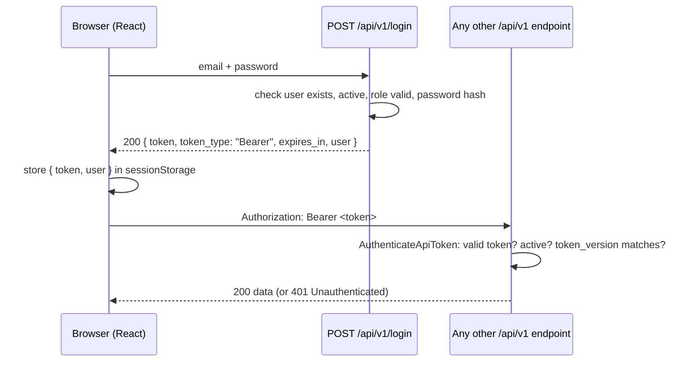

# Authentication and Roles

## Sign-in flow

ASPIRE uses **JWT bearer tokens** (library: `php-open-source-saver/jwt-auth`).

| Fact | Value |
|------|-------|
| Login endpoint | `POST /api/v1/login` (limited to **5 attempts per minute**) |
| Token lifetime | `JWT_TTL` minutes, default **60** |
| Stored in browser | `sessionStorage` key `aspire_session` (cleared when the tab closes) |
| Sign out | `POST /api/v1/logout` revokes the token; the frontend clears the session even if the server is unreachable |
| Password storage | bcrypt hash (`BCRYPT_ROUNDS=12`) |

## Who may sign in

A sign-in is refused (`401 Invalid credentials or inactive account.`) when **any** of these is true:

* the email is unknown or the password is wrong;
* the user is not `active`;
* the user is not a Super Admin but has no center;
* the user is a *placeholder student* (email ending `@students.aspire.local`). Most students are
  created without a login; a Center Admin can enable one.

## Signing a user out everywhere: `token_version`

Every token carries the user's `token_version`. `AuthenticateApiToken` rejects the token when the number
no longer matches the database. Controllers **increment `token_version`** when an account changes in a way
that should end old sessions (deactivation, center reassignment). No token blacklist is needed.

## Roles and what they may call

| Role value | Route prefix | Guard in code |
|------------|--------------|---------------|
| `super_admin` | `/centers`, `/center-admins` | `authorizeAdmin()` in the controller |
| `center_admin` | `/center/*` | `CenterScopedController::centerId()` |
| `teacher` | `/teacher/*`, `/portal/teacher` | `TeacherScopedController::teacherId()` |
| `parent` | `/portal/parent/*`, `/portal/announcements` | checks inside `PortalController` |
| `student` | `/portal/student/*`, `/portal/announcements` | `StudentPortalController::student()` |
| any signed-in user | `/me`, `/logout` | middleware only |

Wrong role → **403**. Not signed in or bad token → **401**. Record belongs to someone else → **404**
(we use "not found" so users cannot discover other centers' data).

## Data isolation (multi-center)

Every query in a role controller is restricted to the caller:

* Center Admin: `where center_id = <their center>`
* Teacher: only classes in `teacherSections()` (and assignments they created)
* Parent: only `children()`
* Student: only `studentSections()`

When you add a new endpoint, **start from the scoped helper** (`$this->centerId($request)`,
`$this->myClass(...)`), never from `Model::find($id)` on its own.

## Private files

Uploaded files are stored on the private disk (`storage/app/private`). The API never exposes the path.
Models add a **temporary signed URL** (valid 2 hours): `AssignmentAttachment::url`, `Submission::file_url`.
The route `GET /api/v1/files/...` (middleware `signed:relative`) streams the file; no bearer token is needed
so `` and `<a>` tags work.

## Response and error format

| Case | Status | Body |
|------|--------|------|
| Success, one record | 200 / 201 | `{ "data": { ... } }` |
| Success, list | 200 | Laravel paginator: `{ "data": [...], "current_page": 1, "last_page": 3, ... }` |
| Validation failed | 422 | `{ "message": "...", "errors": { "field": ["..."] } }` |
| Not signed in | 401 | `{ "message": "Unauthenticated." }` |
| Not allowed | 403 | `{ "message": "..." }` |
| Not found | 404 | `{ "message": "..." }` |
| Business rule | 422 | `{ "message": "Students have already submitted work..." }` |

The frontend's `request()` turns all of these into an `Error` with `.message`, `.status` and `.fields`.
