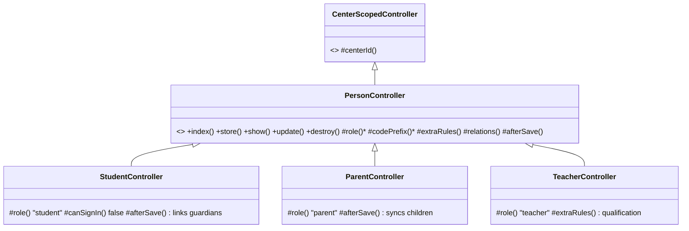

# Backend Guide (Laravel API)

Stack: **PHP 8.3+**, **Laravel 13**, **JWT** (`php-open-source-saver/jwt-auth`), **SQLite**, **PHPUnit 12**, **Laravel Pint**.
Read [Architecture (MVC)](Architecture-MVC) first.

## Request path

`public/index.php` → `bootstrap/app.php` → `routes/api.php` (prefix `/api`, then `v1`) → middleware → controller → model → JSON.

`routes/api.php` shows the structure:

```php
Route::prefix('v1')->group(function (): void {
    Route::post('login', [AuthController::class, 'login'])->middleware('throttle:5,1');
    Route::middleware('signed:relative')->group(/* private file downloads */);
    Route::middleware(AuthenticateApiToken::class)->group(function (): void {
        Route::get('me', ...);   Route::post('logout', ...);
        require __DIR__.'/api-admin.php';    // Super Admin
        require __DIR__.'/api-portal.php';   // parent + teacher portal
        require __DIR__.'/api-student.php';  // student portal
        require __DIR__.'/api-teacher.php';  // teacher workspace
        require __DIR__.'/api-center.php';   // Center Admin workspace
    });
});
```

One route file per role keeps each file short. **A new endpoint goes into the file of the role that uses it.**

## Controllers

| Folder / file | Role | Notes |
|---------------|------|-------|
| `AuthController` | everyone | login, me, logout |
| `CenterController`, `CenterAdminController` | Super Admin | `authorizeAdmin()` first line of every method |
| `Center/CenterScopedController` | base | `centerId()` gives the admin's center or aborts 403 |
| `Center/PersonController` | base | generic CRUD for people; subclasses override small hooks |
| `Center/StudentController`, `ParentController`, `TeacherController` | Center Admin | declare `role()`, `codePrefix()`, `extraRules()`, `afterSave()` |
| `Center/SubjectController`, `ClassController`, `DashboardController` | Center Admin | |
| `Teacher/TeacherScopedController` | base | `teacherId()`, `myClass()`, `myAssignment()` |
| `Teacher/AssignmentController`, `AttendanceController`, `AnnouncementController`, `SubmissionController`, `ClassController`, `DashboardController` | Teacher | |
| `PortalController`, `StudentPortalController` | Parent / Student | |
| `FileController` | signed URLs | streams private files |
| `Concerns/SavesSubmissions`, `Concerns/ShowsStudentWork` | traits | shared by student, parent and teacher endpoints |

### The template-method pattern (`PersonController`)

Students, parents and teachers are all rows in `users`, so the CRUD is written **once**:



To add another kind of person, extend `PersonController` and implement `role()` and `codePrefix()`.

## Validation

Validation lives **in the controller**, right after the permission check, as arrays:

```php
$data = $request->validate([
    'title'   => ['required', 'string', 'max:255'],
    'due_at'  => ['required', 'date'],
    'status'  => ['sometimes', Rule::in(['draft', 'published', 'closed'])],
]);
```

Rules that need the current record (unique-ignoring-self, "partial update") are built in a private `rules()`
method that takes the record or `null`, as in `CenterController::rules()`. A failed validation automatically
returns **422** with `errors`; the frontend shows them next to the fields.

## Transactions

When one request writes several tables, wrap them: `DB::transaction(function () { ... })`
(see `ClassController::store`, `PersonController::store`). Either everything is saved or nothing.

## Files

`$file->store("submissions/{$assignment->id}", 'local')` saves to `storage/app/private/...`.
Delete with `Storage::disk('local')->delete($path)`. See [Authentication and Roles](Authentication-and-Roles#private-files).

## Useful artisan commands

| Command | Use |
|---------|-----|
| `php artisan route:list --path=api` | All endpoints |
| `php artisan make:migration name` | New migration |
| `php artisan make:model Name` | New model |
| `php artisan make:controller Api/Teacher/NameController` | New controller |
| `php artisan make:test NameTest` | New feature test |
| `php artisan tinker` | Try Eloquent in a shell |
| `php artisan config:clear` | Forget cached config after editing `.env` |
| `php artisan pail` | Live log tail |

## Configuration files you may edit

| File | Purpose |
|------|---------|
| `config/aspire.php` | Initial Super Admin settings from `.env` |
| `config/jwt.php` | Token lifetime and algorithm |
| `config/filesystems.php` | Private/public disks |
| `.env` | Your local secrets and switches (never committed) |

## AI-assistant helper files

`backend/CLAUDE.md`, `backend/AGENTS.md` and `backend/.claude/skills/` contain Laravel best-practice rules
used by coding assistants. They are optional reading, but their style rules match this wiki.
