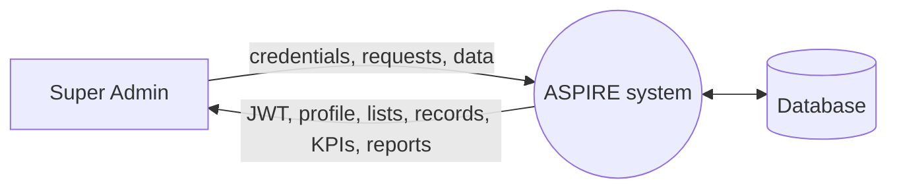
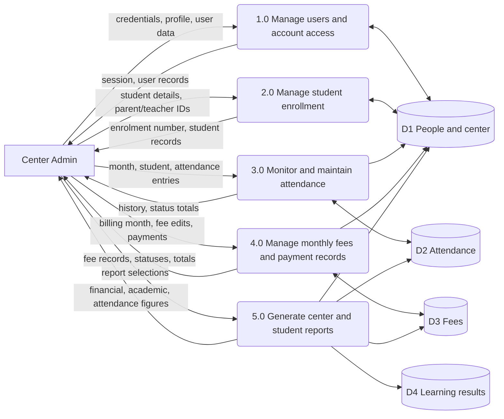
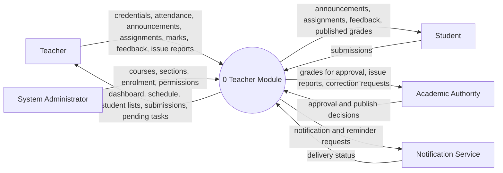
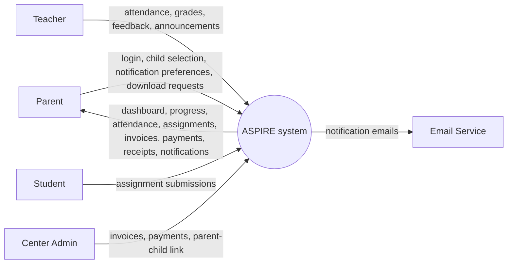
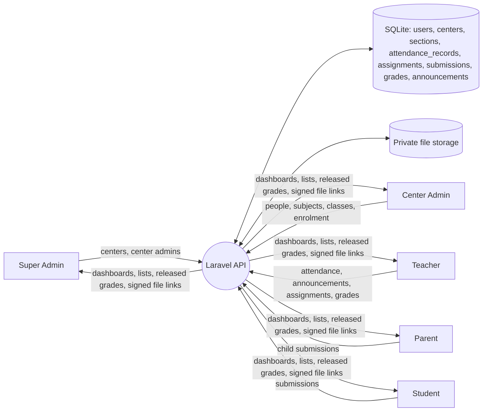

# Data Flow Diagrams (DFD)

A DFD shows **how data moves**: who sends data in (external entities), what transforms it (processes),
and where it rests (data stores). Notation used here: rectangles = external entities, rounded boxes =
processes, cylinders = data stores, arrows = data flows.

PDF sources (in `diagram/` on `main`):

| Module | File |
|--------|------|
| Super Admin | [Context diagram](https://github.com/Nakib00/aspire-system/blob/main/diagram/data_flow_diagram/super_admin_nakib/Data%20Flow%20Diagrams%201.pdf) · [Level 0](https://github.com/Nakib00/aspire-system/blob/main/diagram/data_flow_diagram/super_admin_nakib/Data%20Flow%20Diagrams%202.pdf) |
| Center Admin | [Level 0 with flow table DF-01…DF-24](https://github.com/Nakib00/aspire-system/blob/main/diagram/center_admin/Data%20Flow%20Diagram.pdf) |
| Teacher | [Level 0](https://github.com/Nakib00/aspire-system/blob/main/diagram/data_flow_diagram/Teacher_Ataur/DFD_Level0_Teacher_Ataur.pdf) |
| Parent | [Level 0](https://github.com/Nakib00/aspire-system/blob/main/diagram/data_flow_diagram/parent_farhana/DFD0_Parent_Farhana.drawio.pdf) |

The diagrams below re-draw the content of those PDFs as text diagrams so they can be read and reviewed in the wiki.

## Level 0: Super Admin (context)

The Super Admin exchanges data with one system. Flows named in the diagram: login credentials → **JWT token and profile**;
user, center-admin and parent lists; center records and statistics; subject/level lists and worksheet files;
teacher/student records and enrolment numbers; assignment and submission lists and files; attendance history and
summaries; fee records, outstanding fees and summaries; dashboard KPIs and reports.

## Level 0: Center Admin (5 processes, 4 stores)

| Store | Content |
|-------|---------|
| D1 | People and center records |
| D2 | Attendance |
| D3 | Fees |
| D4 | Learning results |

## Level 0: Teacher

| Entity | Sends to the Teacher Module | Receives |
|--------|----------------------------|----------|
| Teacher | Login credentials, attendance, announcements, assignments, marks, feedback, issue reports | Dashboard, class schedule, student lists, submissions, pending tasks, notifications |
| Student | Assignment submissions | Announcements, assignments, feedback, published grades, notifications |
| Academic Authority | Approval and publish decisions | Grades for approval, issue reports, correction requests |
| System Administrator | Courses, sections, teacher assignments, enrolment, permissions | n/a |
| Notification Service | Delivery status | Notification and reminder requests |

## Level 0: Parent

## As-built data flow (derived from the code)

This diagram is **not** one of the original PDFs. It shows what the implemented system actually does today.

## How to read and draw a DFD

1. Level 0 (context): one process, all external entities, the main flows.
2. Level 1: split the process into 3–7 numbered sub-processes (1.0, 2.0 …) and add data stores (D1, D2 …).
3. Every flow is a **noun phrase** (what data), never a verb.
4. Data never flows directly between two stores or two external entities; it always passes a process.
5. Number the flows (DF-01 …) and list them in a table as the Center Admin document does.
