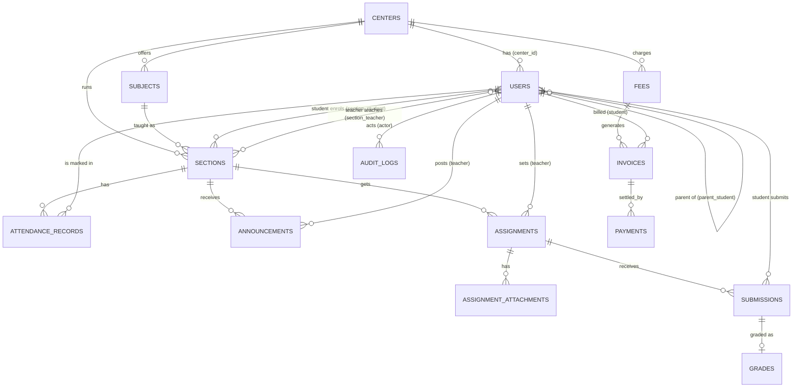

# Database

ASPIRE uses **SQLite** (one file: `backend/database/database.sqlite`). The schema is created by
**migrations** in `backend/database/migrations/`; never edit the database by hand and never edit an
old migration that has already been shared. Add a new migration instead.

## Entity-relationship diagram



There is **one `users` table for every role**. The `role` column tells them apart.

## Conventions

| Rule | Example |
|------|---------|
| Table names: plural `snake_case` | `attendance_records` |
| Column names: `snake_case` | `due_at`, `max_marks` |
| Primary key: `id` | |
| Foreign key: `<singular_table>_id` (or a role name when the target is `users`) | `section_id`, `teacher_id`, `student_id` |
| Pivot table: both singular names, alphabetical-ish | `section_student`, `parent_student` |
| Timestamps on every table | `created_at`, `updated_at` |
| Money in the smallest unit (integer) | `amount_minor` (e.g. paisa/cents) |
| Booleans as `tinyint` | `active`, `published`, `pinned` |
| Dates `date`, moments `datetime` | `date_of_birth`, `submitted_at` |
| Lists/objects stored as JSON text, cast by the model | `operating_days`, `days`, `questions` |

## Tables

### `users`: every person

| Column | Type | Notes |
|--------|------|-------|
| `id` | integer PK | |
| `center_id` | integer, nullable | Center of the user. `NULL` only for Super Admin. Indexed. |
| `role` | string | `super_admin`, `center_admin`, `teacher`, `parent`, `student`. Indexed. |
| `active` | boolean | Inactive users cannot sign in. |
| `name`, `email`, `password` | string | `email` is unique. `password` is hashed (bcrypt). |
| `code` | string, unique | Member code: `STU-00012`, `TCH-…`, `PAR-…`, `ADM-…`. |
| `phone`, `address`, `gender`, `date_of_birth`, `notes` | optional | Profile. |
| `designation` | string | Center Admin job title. |
| `school_name`, `grade_level` | string | Students. |
| `qualification`, `joined_on` | string, date | Teachers. |
| `token_version` | integer | Bumped to sign the user out everywhere (see [Authentication and Roles](Authentication-and-Roles)). |
| `last_login_at` | datetime | Set on sign-in. |
| `email_verified_at`, `remember_token` | | Laravel defaults, unused. |

### `centers`

| Column | Type | Notes |
|--------|------|-------|
| `id` | PK | |
| `name` | string, **unique** | |
| `code` | string, unique | Generated `CTR-001` when not supplied. |
| `address`, `city`, `postal_code`, `phone`, `email` | string | Contact details. |
| `contact_person`, `contact_phone` | string | |
| `capacity` | integer | Maximum students. |
| `established_on` | date | |
| `opens_at`, `closes_at` | string `HH:MM` | |
| `operating_days` | JSON | e.g. `["sat","sun","mon"]` |
| `status` | string | `active` / `inactive`. |
| `notes` | text | |

### `subjects`

`id`, `center_id` (→ centers, cascade), `name`, `code`, `description`, `status`. **Unique** `(center_id, name)`.

### `sections`: a *class*

In the code and API a class is called a **Section** (the model) / **class** (the URL).

| Column | Type | Notes |
|--------|------|-------|
| `center_id` | FK → centers (restrict) | |
| `subject_id` | FK → subjects (set null) | Preferred link to the subject. |
| `subject` | string | Text copy of the subject's name. Required, part of the unique key, and kept in sync by `Center/ClassController` and `Center/SubjectController` (renaming a subject updates its classes). |
| `name` | string | e.g. "Math Grade 5 A". **Unique** `(center_id, name, subject)`. |
| `capacity`, `room` | | |
| `days` | JSON | `["sun","tue"]` |
| `starts_at`, `ends_at` | string `HH:MM` | Daily time. |
| `starts_on`, `ends_on` | date | Term dates. |
| `status` | string | `active` / `inactive`. |
| `description` | text | |

### Pivot tables

| Table | Links | Extra | Unique |
|-------|-------|-------|--------|
| `section_student` | class ↔ student | | `(section_id, student_id)` |
| `section_teacher` | class ↔ teacher | | `(section_id, teacher_id)` |
| `parent_student` | parent ↔ student | `relationship` (e.g. "Mother") | `(parent_id, student_id)` |

### `attendance_records`

`section_id`, `student_id`, `date`, `status` (`present` / `late` / `absent` / `excused`), `note`,
`marked_by` (→ users, set null). **Unique** `(section_id, student_id, date)`: no duplicate marks for the same
class day. Index `(section_id, date)`.

### `announcements`

`section_id`, `teacher_id`, `title` (optional), `body`, `pinned`. Index `(section_id, created_at)`.

### `assignments`

| Column | Notes |
|--------|-------|
| `section_id`, `teacher_id` | Class and author. |
| `title`, `instructions` | |
| `due_at` | datetime |
| `max_marks` | integer, default 100 |
| `youtube_url` | optional; the model extracts `youtube_id` |
| `questions` | JSON: `[{ "text": "...", "marks": 5 }]` |
| `status` | `draft` (default) → `published` → `closed`. Only published work is visible to students. |
| `attachment_path` | Legacy single-file column; use `assignment_attachments`. |

### `assignment_attachments`

`assignment_id` (cascade), `kind` (`pdf` / `image`), `path` (private disk), `original_name`, `mime`, `size`.
`path` is hidden from JSON; clients get a signed `url` instead.

### `submissions`

`assignment_id`, `student_id`, `text_answer`, `file_path`, `original_name`, `submitted_at`, `opened_at`
(first time a teacher opened it), `status` (`submitted` / `late`), `submitted_by` (who uploaded: student,
parent or teacher). **Unique** `(assignment_id, student_id)`: one submission per student; a resubmission replaces it.

### `grades`

`submission_id` (**unique**, one grade per submission), `teacher_id`, `marks` (decimal), `feedback`, `published`.
Parents and students see marks and feedback only when `published = true`.

### Designed, not yet used by code

| Table | Purpose |
|-------|---------|
| `fees` | A charge of a center (`title`, `amount_minor`, `due_date`). |
| `invoices` | Fee for one student (`total_minor`, `due_minor`, `status`). Unique `(fee_id, student_id)`. |
| `payments` | Payment on an invoice (`amount_minor`, `paid_on`, `method`, `status`, `recorded_by`). |
| `notifications` | Laravel notification store (uuid id, polymorphic `notifiable`). |
| `audit_logs` | `actor_id`, `action`, polymorphic `auditable`, `old_values`, `new_values`. |

Models exist for fees, invoices, payments and audit logs; there are no controllers yet. See [Implementation Status](Implementation-Status).

### Framework and leftover tables

| Table | Notes |
|-------|-------|
| `migrations` | Which migrations ran. |
| `cache`, `cache_locks`, `jobs`, `job_batches`, `failed_jobs`, `sessions`, `password_reset_tokens` | Laravel defaults. |
| `api_tokens` | **Unused.** Left from an earlier custom-token design; login now uses JWT. Safe to drop in a future migration. |

## Delete rules (what happens to related rows)

| Relation | On delete |
|----------|-----------|
| center → sections, fees | **restrict** (cannot delete a center that has them) |
| center → subjects | cascade |
| section → attendance, announcements, enrolments | cascade |
| assignment → attachments | cascade |
| assignment/user → submissions, grades, assignments | **restrict** (work is never silently lost) |
| subject → sections | set null |
| user → `marked_by`, `submitted_by`, audit `actor_id` | set null |

## Migrations: how to change the schema

```bash
cd backend
php artisan make:migration add_room_to_sections_table --table=sections
```

Edit the new file (`up` adds, `down` reverses), then:

```bash
php artisan migrate            # apply
php artisan migrate:rollback   # undo the last batch
php artisan migrate:fresh      # drop everything and start again (local only!)
```

Checklist for a schema change: write the migration → update the model (`casts`, relations, docblock) →
update controller validation → add/adjust a feature test → update this page.

Migration files (in order):

| File | Adds |
|------|------|
| `0001_01_01_000000…000002` | Laravel `users`, cache, jobs |
| `2026_01_01_000000_create_aspire_tables` | centers, sections, pivots, fees, invoices, payments, assignments, submissions, grades, notifications, audit_logs |
| `2026_11_16_193926_create_api_tokens_table` | `api_tokens` (now unused) |
| `2026_11_16_194409_add_token_version_to_users_table` | `users.token_version` |
| `2026_11_17_090000_add_management_details_to_centers_and_users` | center details, user profile fields, `code` |
| `2026_11_18_090000_add_people_subjects_and_class_details` | `subjects`, class schedule fields, `relationship` |
| `2026_11_19_090000_add_attendance_and_assignment_resources` | attendance, attachments, questions, text answers |
| `2026_11_20_090000_create_announcements_table` | `announcements` |

## Seeders

| Seeder | Command | What it does |
|--------|---------|--------------|
| `DatabaseSeeder` | `php artisan db:seed` | Creates the Super Admin from `INITIAL_ADMIN_*` in `.env`. Safe to run twice. |
| `DemoSeeder` | `php artisan db:seed --class=DemoSeeder` | One demo center (`DEMO-01`) with admin, teachers, subjects, classes, students, parents, attendance, assignments and grades. Skips if already loaded. |

## Querying tips for new developers

* Use the model relations (`$section->students`) instead of raw SQL.
* Eager-load to avoid slow lists: `Section::with('subject', 'teachers')->get()`.
* To look at data, open `backend/database/database.sqlite` with *DB Browser for SQLite* (https://sqlitebrowser.org) or the VS Code "SQLite Viewer" extension.
* `backend/database/aspire-template.sqlite` is an **old snapshot**. Prefer `php artisan migrate`.
