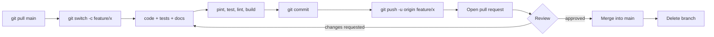

# Git Workflow and Code Review

All **source code and documents** (code, SRS, diagrams, wiki source) live in one Git repository:
https://github.com/Nakib00/aspire-system. Nothing is shared by e-mail or chat: if it is not in Git, it does not exist.

## Branches

| Branch | Purpose |
|--------|---------|
| `main` | Always works. Only changed through a reviewed pull request (PR). |
| `super-admin-nakib`, `centeradmin-joy`, `teacher-ataur`, `parent-farhana` | Long-running module branches the team used so far (one per role/owner). |
| `feature/<short-name>` | **New work** (recommended from now on), e.g. `feature/attendance-report` |
| `fix/<short-name>` | Bug fix, e.g. `fix/late-status-timezone` |
| `docs/<short-name>` | Documentation only, e.g. `docs/wiki-database` |

Branch names are lowercase, words separated by dashes.

## The loop (every change)



```bash
git switch main && git pull                  # 1. start from the latest main
git switch -c feature/attendance-report      # 2. your own branch

# ... edit, test ...

cd backend && vendor/bin/pint && php artisan test && cd ..     # 3. quality gate
cd frontend && npm run lint && npm run build && cd ..

git status                                   # 4. look at what changed (no .env, no vendor!)
git add backend/app/... frontend/src/...     #    add files by name, not `git add .`
git commit -m "feat: add attendance report for teachers"
git push -u origin feature/attendance-report # 5. publish, then open a PR on GitHub
```

Keep up to date with others while you work: `git fetch origin && git merge origin/main` (resolve conflicts, run the tests again).

## Commit messages

Format: `<type>: <what you did, imperative, ≤ 72 characters>`

| Type | Use for |
|------|---------|
| `feat` | New behaviour |
| `fix` | Bug fix |
| `docs` | Documentation, wiki, diagrams |
| `refactor` | Restructure without changing behaviour |
| `test` | Tests only |
| `style` | Formatting only (Pint) |
| `chore` | Tooling, dependencies |

Good: `fix: mark submissions after the due time as late`
Bad: `update`, `changes`, `final final v2`

One commit = one idea. A body (blank line, then explanation) is for the **why**.

## Pull requests

**Title** like a commit message. **Description** has:

1. **What & why**: one paragraph.
2. **How to test**: steps or the test name.
3. **Screenshots** for UI changes.
4. Link to the user story / use case (e.g. "US-T3, UC-T03").
5. The checklist from [Coding Standards and Naming](Coding-Standards-and-Naming#6-pull-request-checklist-copy-into-your-pr).

Keep PRs **small** (ideally under ~400 changed lines). Big PRs are not reviewed well.

## Code review

We use **GitHub pull request reviews** as our code-review tool: line comments, "Request changes" /
"Approve", and the PR history are the permanent record. Past examples: PRs #5, #8 and #9 merged the
Super Admin and Center Admin modules.

Automated helpers run before a human looks:

| Tool | Command | What it catches |
|------|---------|-----------------|
| Laravel Pint | `vendor/bin/pint --test` | PHP style |
| PHPUnit | `php artisan test` | Broken behaviour |
| oxlint | `npm run lint` | JS mistakes, hook rule violations |
| Vite build | `npm run build` | Import and syntax errors |
| Claude Code `/code-review` | in the editor | Optional extra pair of eyes on a diff |

### Reviewer checklist

**Correctness**
- [ ] Does it do what the user story / issue asks? Edge cases (empty, duplicate, too large)?
- [ ] Is every endpoint **scoped** to the caller and role-checked? Is input validated?
- [ ] Are errors handled (try/catch on the frontend, 422/403/404 on the backend)?

**Design**
- [ ] Is code in the right MVC layer? (see [Architecture (MVC)](Architecture-MVC))
- [ ] Any copy-paste that should be a trait / component / helper?

**Quality**
- [ ] Tests added for new behaviour and for permissions?
- [ ] Names follow the cheat sheet? Doc blocks added/updated?
- [ ] No secrets, `.env`, database files, `console.log`/`dd()` left behind?

**UI** (if relevant)
- [ ] Loading, empty and error states? Keyboard usable? Matches existing components?

### Review etiquette

* Review within one working day. Be specific and kind: suggest, explain why, praise good parts.
* Prefix minor points with `nit:` so the author knows they are optional.
* The author answers every comment, then resolves it. Do not merge your own PR without a second person.
* Use **Squash and merge** to keep `main` readable (one commit per PR).

## Rules that protect the project

1. Never commit to `main` directly. (Recommended setting: GitHub → Settings → Branches → require a PR and one approval.)
2. Never force-push a shared branch.
3. Never commit secrets or generated files (`.env`, `vendor/`, `node_modules/`, `database.sqlite`, `storage/app/private`).
4. Never rewrite history that others have pulled.
5. If you committed a secret, tell the team **immediately**; the secret must be changed (deleting the commit is not enough).

## Documents in Git

Analysis and design documents are versioned too:

| Folder | Content |
|--------|---------|
| `diagram/user-stories`, `diagram/fr-nfr` | User stories, SRS |
| `diagram/use_case_diagram`, `diagram/use-case-narratives` | Use cases |
| `diagram/data_flow_diagram`, `diagram/state_diagrams`, `diagram/uml_diagram`, `diagram/center_admin` | DFD, state, class diagrams |

Add a new document in the matching folder, commit with `docs: ...`, and add it to the [Document Index](Document-Index).
Folder names use lowercase with underscores or dashes; file names include the module and owner, e.g. `teacher_fr_nfr_ataur.pdf`.

## Publishing this wiki

The wiki is written as Markdown in the repository folder `wiki/`, so wiki changes are **reviewed in a PR like code**.
After a PR is merged, publish to the GitHub Wiki:

```bash
# one-time
git clone https://github.com/Nakib00/aspire-system.wiki.git ../aspire-wiki
# every time
cp -r wiki/* ../aspire-wiki/
cd ../aspire-wiki && git add -A && git commit -m "docs: sync wiki" && git push
```

(The GitHub Wiki must be enabled under Settings → Features, and its first page created once in the browser.)
