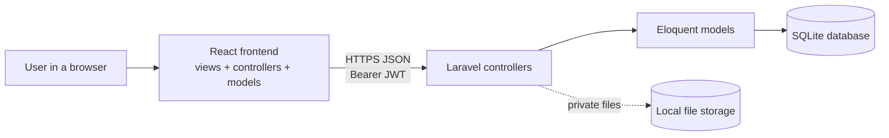

# ASPIRE Wiki

**ASPIRE** (After-School Program Integrated Resource & Education System) is a web system that helps an
after-school education center run its day-to-day work: people, classes, attendance, assignments,
grading, announcements and (designed) fees.

This wiki is the single place a **new developer** should read before touching the code. It explains
what the product is, how to run it on your computer, how the code is organised, how we write and
review code, and where the analysis and design documents are.

> **New here? Follow this path (about 45 minutes):**
> 1. [Project Overview](Project-Overview): what we are building and for whom.
> 2. [Getting Started](Getting-Started): install the tools and run the project.
> 3. [Architecture (MVC)](Architecture-MVC) and [Folder Structure](Folder-Structure): where things live.
> 4. [Coding Standards and Naming](Coding-Standards-and-Naming): how to write code that fits in.
> 5. [Git Workflow and Code Review](Git-Workflow-and-Code-Review): how your change reaches `main`.
> 6. Pick a task from the [Onboarding Checklist](Onboarding-Checklist).

## Page map

| Area | Pages |
|------|-------|
| **Start** | [Project Overview](Project-Overview) · [Getting Started](Getting-Started) · [Troubleshooting and FAQ](Troubleshooting-and-FAQ) · [Onboarding Checklist](Onboarding-Checklist) |
| **Code** | [Architecture (MVC)](Architecture-MVC) · [Folder Structure](Folder-Structure) · [Backend Guide](Backend-Guide) · [Frontend Guide](Frontend-Guide) · [Authentication and Roles](Authentication-and-Roles) |
| **Data** | [Database](Database) · [Models Reference](Models-Reference) · [API Reference](API-Reference) |
| **Quality** | [Coding Standards and Naming](Coding-Standards-and-Naming) · [Source Code Documentation](Source-Code-Documentation) · [Testing Guide](Testing-Guide) · [Writing Test Cases](Writing-Test-Cases) · [Test Results](Test-Results) · [UI Design and Nielsen Heuristics](UI-Design-and-Nielsen-Heuristics) |
| **Process** | [Git Workflow and Code Review](Git-Workflow-and-Code-Review) · [Team and Roles](Team-and-Roles) |
| **Analysis and design** | [User Stories](User-Stories) · [SRS](SRS-Requirements) · [Use Cases](Use-Cases) · [DFD](Data-Flow-Diagrams) · [State Diagrams](State-Diagrams) · [SDS and Class Diagrams](SDS-Design) · [Document Index](Document-Index) |
| **Reference** | [Glossary](Glossary) · [Implementation Status](Implementation-Status) |

## The system in one picture

## Five roles

| Role | Short description |
|------|-------------------|
| Super Admin | Creates centers and Center Admin accounts. System-wide. |
| Center Admin | Manages one center: students, parents, teachers, subjects, classes, enrolment. |
| Teacher | Takes attendance, posts announcements, sets and grades assignments. |
| Parent | Follows their children: attendance, work, results, announcements. |
| Student | Sees classes, submits assignments, reads released results. |

## Quick facts

| Item | Value |
|------|-------|
| Repository | https://github.com/Nakib00/aspire-system |
| Backend | PHP 8.3+, Laravel 13, JWT authentication |
| Frontend | React 19, Vite |
| Database | SQLite (file) |
| Default branch | `main` |
| Backend URL (local) | http://127.0.0.1:8000 |
| Frontend URL (local) | http://localhost:5173 |
