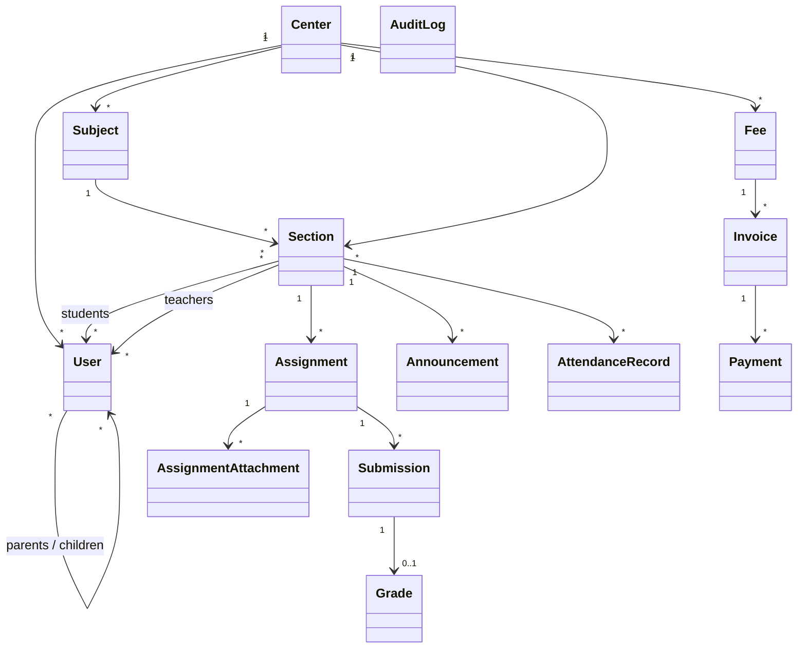

# Models Reference

Models live in `backend/app/Models/`. Each one is an **Eloquent** class: one class = one table, and
its methods describe how it relates to other models. This page is your map. For columns see [Database](Database).

> Naming: class names are **singular PascalCase** (`Section`), table names **plural snake_case** (`sections`),
> relation methods **camelCase** (`studentSections`).

## Relationship overview



## Model by model

### `User`
One class for all five roles (`role` column). Implements `JWTSubject` so it can be put into a token.

| Member | Kind | Meaning |
|--------|------|---------|
| `center()` | belongsTo | Center the user works or studies in |
| `children()` | belongsToMany(User) | For a **parent**: their students (pivot `relationship`) |
| `parents()` | belongsToMany(User) | For a **student**: their guardians |
| `studentSections()` | belongsToMany(Section) | Classes a **student** attends |
| `teacherSections()` | belongsToMany(Section) | Classes a **teacher** teaches |
| `getJWTIdentifier()`, `getJWTCustomClaims()` | JWT | Put `token_version` in the token |
| Casts | | `password` hashed, `active` boolean, dates |
| Hidden from JSON | | `password`, `remember_token`, `token_version` |

### `Center`
Tenant. Relations: `users()`, `sections()`, `subjects()`, `fees()`. Casts: `operating_days` array, `established_on` date, `capacity` integer.

### `Subject`
A subject a center teaches. Relations: `center()`, `sections()`.

### `Section` (a class)
Subject + schedule + capacity. Relations: `subject()`, `center()`, `students()`, `teachers()`,
`attendanceRecords()`, `assignments()`. Casts: `days` array, `capacity` integer, dates.

### `AttendanceRecord`
`section()`, `student()`. Constant `STATUSES = ['present','late','absent','excused']`.

### `Announcement`
`section()`, `teacher()`. Cast: `pinned` boolean.

### `Assignment`
`section()`, `teacher()`, `attachments()`, `submissions()`. Accessor `youtube_id` (parsed from `youtube_url`,
appended to JSON). Casts: `due_at` datetime, `questions` array, `max_marks` integer.

### `AssignmentAttachment`
`assignment()`. Accessor `url` → 2-hour signed link. `path` hidden.

### `Submission`
`assignment()`, `student()`, `submittedBy()`, `grade()` (hasOne). Accessor `file_url` → signed link. `file_path` hidden.

### `Grade`
`submission()`, `teacher()`. Casts: `marks` float, `published` boolean.

### Not yet used by controllers
`Fee` (`center()`, `invoices()`), `Invoice` (`fee()`, `student()`, `payments()`), `Payment` (`invoice()`, `recorder()`),
`AuditLog` (`actor()`, `auditable()` polymorphic).

## Writing a new model: template

```php
<?php

namespace App\Models;

use Illuminate\Database\Eloquent\Model;
use Illuminate\Database\Eloquent\Relations\BelongsTo;

/**
 * One sentence: what a row of this table means.
 *
 * Model in the MVC architecture: owns the data, relations and casts for this table.
 */
class Example extends Model
{
    protected $guarded = ['id'];

    /** @return array<string, string> */
    protected function casts(): array
    {
        return ['published' => 'boolean'];
    }

    /** The section this example belongs to. */
    public function section(): BelongsTo
    {
        return $this->belongsTo(Section::class);
    }
}
```

Rules: relations always have a **return type** and a one-line comment; mass assignment uses `$guarded = ['id']`;
no HTTP code inside models; keep accessors small and pure.
