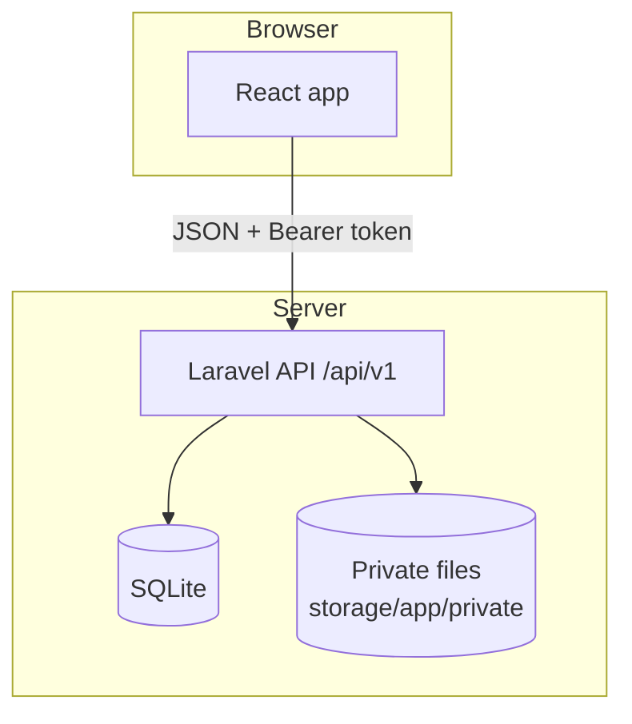

# Project Overview

## What is ASPIRE?

ASPIRE is a web system for **after-school education centers**. A center teaches school-age students
in small classes. Today, such centers often use paper and chat groups. ASPIRE brings enrolment,
attendance, homework, grades and parent communication into one place.

## Objectives

* Simplify the administrative work of a center.
* Give teachers, parents and students one transparent flow of information.
* Keep each student's progress visible to everyone allowed to see it.
* Support many centers inside one system (each center only sees its own data).

## Who uses it (roles)

| Role | Owner in the team | Can do | Sees |
|------|-------------------|--------|------|
| **Super Admin** | Nakib | Create and edit centers, create Center Admin accounts, activate/deactivate them | All centers |
| **Center Admin** | Joy | Manage students, parents, teachers, subjects, classes and enrolment; see the center dashboard | Own center only |
| **Teacher** | Ataur | Take attendance, post announcements, create assignments, review and grade submissions, release grades | Own classes only |
| **Parent** | Farhana | See child progress, attendance, assignments, results and announcements; submit work for a child | Own children only |
| **Student** | Azmann | See classes, submit assignments, read released results and attendance | Own data only |

## Key features (what works today)

* Sign in with email and password; role-based access; instant sign-out when an account changes.
* **Super Admin:** centers (profile, contact, capacity, opening hours), Center Admin accounts.
* **Center Admin:** dashboard with "needs attention" list; students (with guardians), parents,
  teachers; subjects; classes with schedule, room, capacity and enrolment.
* **Teacher:** dashboard; class list; attendance sheet and attendance report; announcements;
  assignments with questions, YouTube link and file attachments; submission review; grading with
  feedback; releasing grades to parents.
* **Parent / Student portals:** classes, assignments and submission, released results, attendance,
  announcements.

Features that were **designed** in the analysis documents but are **not built yet** (fees and payments,
notifications, reports, worksheets/levels) are listed on [Implementation Status](Implementation-Status).

## How the pieces fit together

## Typical day (example flow)

1. **Super Admin** creates *Dhanmondi Learning Hub* and a Center Admin account.
2. **Center Admin** adds teachers, students and parents, creates *Math Grade 5*, assigns a teacher and enrols students.
3. **Teacher** takes attendance, posts "Quiz on Sunday", creates an assignment.
4. **Student** (or a parent) submits work before the due date.
5. **Teacher** reviews, grades and writes feedback (grades are released to families by default and can be held back).
6. **Parent** sees the released result and the attendance.

## Course context

ASPIRE is a Software Engineering course project (CSE451). It includes SRS and SDS documentation,
MVC architecture, unit/feature tests, code review through pull requests, Git version control and a UI
designed with Nielsen's usability heuristics. Each of those has a wiki page; see the
[Home](Home) page map.
