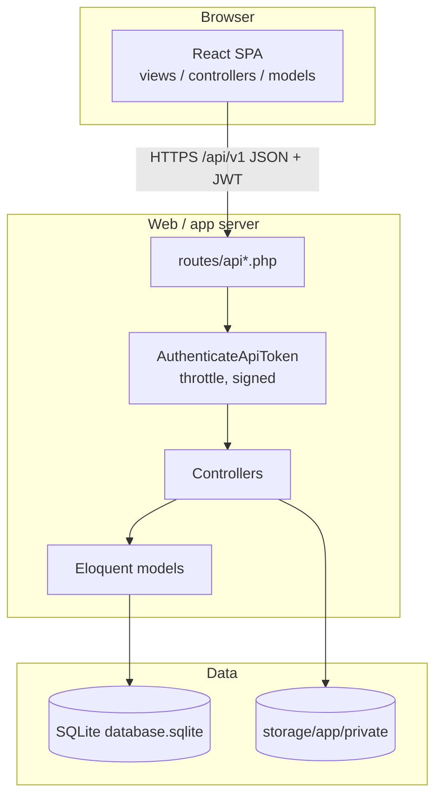
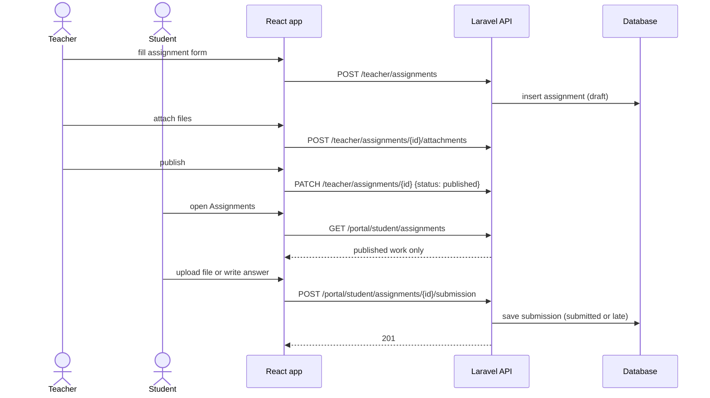
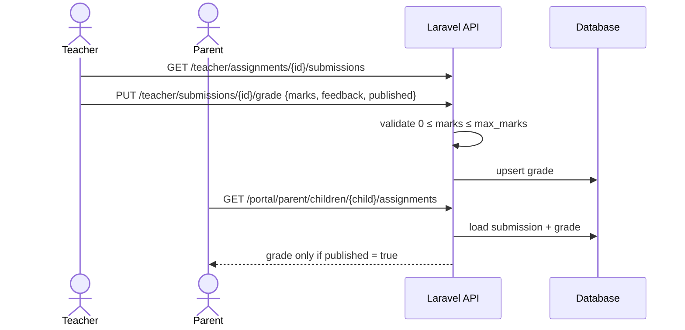
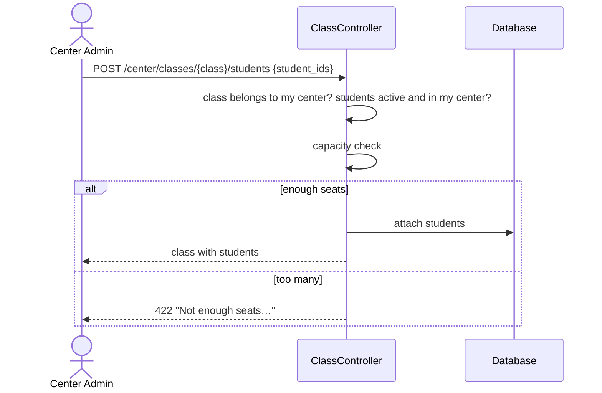

# SDS: Software Design Specification

The SDS explains **how** the system meets the [SRS](SRS-Requirements). It brings together architecture,
class design, data design, key sequences and design decisions. Detailed pages are linked rather than repeated.

## Completeness checklist

| SDS part | Where | Status |
|----------|-------|--------|
| Architecture (MVC, layers) | [Architecture (MVC)](Architecture-MVC) | ✅ |
| Component and deployment view | this page, section 2 | ✅ |
| Class diagrams (design) | PDFs below + [Models Reference](Models-Reference) (as built) | ✅ Super Admin, Center Admin · ⬜ Teacher, Parent |
| Database design | [Database](Database) | ✅ |
| Interface design (API) | [API Reference](API-Reference) | ✅ |
| User interface design | [UI Design and Nielsen Heuristics](UI-Design-and-Nielsen-Heuristics) | ✅ |
| Behaviour (state diagrams) | [State Diagrams](State-Diagrams) | ✅ |
| Data flow | [Data Flow Diagrams](Data-Flow-Diagrams) | ✅ |
| Security design | [Authentication and Roles](Authentication-and-Roles) | ✅ |
| Key sequences | this page, section 4 | ✅ |
| Design decisions | this page, section 5 | ✅ |
| Traceability to requirements | [SRS](SRS-Requirements) section 7 | ✅ |

## 1. Class diagrams (design documents)

| Module | PDF | Content |
|--------|-----|---------|
| Super Admin | [SuperAdmin_Class_Diagram.pdf](https://github.com/Nakib00/aspire-system/blob/main/diagram/uml_diagram/super_amidn_nakib/SuperAdmin_Class_Diagram.pdf) | `User` (abstract) with `SuperAdmin`, `CenterAdmin`, `Teacher`, `Student`, `Parent`; `Center`, `Subject`, `Level`, `Worksheet`, `Assignment`, `Submission`, `Attendance`, `Fee`, `StudentProgress`, `Report`; interfaces `Activatable`, `JWTSubject`, `FileAttachable`; enum `Role` |
| Center Admin | [Class Diagram.pdf](https://github.com/Nakib00/aspire-system/blob/main/diagram/center_admin/Class%20Diagram.pdf) | `User`, `Teacher`, `Student`, `Center`, `Attendance`, `Fee`, `Assignment`, `Submission` with multiplicities and a class/relationship table |

**Design vs build:** the design uses one class per role (inheritance from `User`). The build uses **one `User`
model with a `role` column** (single-table approach): simpler migrations, one login path, and the role
decides behaviour in controllers. Worksheets/levels in the design became *classes with assignments* in the build.

### As-built class model

See the diagram in [Models Reference](Models-Reference#relationship-overview).

## 2. Components and deployment

| Environment | Frontend | Backend | Database |
|-------------|----------|---------|----------|
| Development | `npm run dev` on :5173, proxies `/api` | `php artisan serve` on :8000 | SQLite file |
| Production (suggested) | `npm run build` → static files from any web server | PHP-FPM + Nginx/Apache behind HTTPS | SQLite for small centers, or MySQL/PostgreSQL after testing |

## 3. Data design

Entities, columns, keys and delete rules are in [Database](Database). Design principles:

* One `users` table for all roles; relationships (parent↔student, student↔class, teacher↔class) are pivot tables.
* Multi-center isolation through `center_id` plus controller scoping.
* Money in integer minor units; flexible lists (days, questions) as JSON cast by the model.
* Work is never silently deleted: `restrict` on submissions and grades.

## 4. Key sequences

### 4.1 Sign in

See the diagram in [Authentication and Roles](Authentication-and-Roles#sign-in-flow).

### 4.2 Teacher creates an assignment and a student submits

### 4.3 Teacher grades, family sees result

### 4.4 Center Admin enrols a student

## 5. Design decisions and patterns

| Decision | Why | Where |
|----------|-----|-------|
| **MVC** on both sides | Separate data, presentation and control; easy to find and test code | [Architecture (MVC)](Architecture-MVC) |
| **REST + JSON API**, separate SPA | Frontend and backend can be developed and deployed independently; same API can serve a mobile app later | `routes/api*.php` |
| **JWT with `token_version`** | Stateless API, but still able to sign a user out everywhere | `AuthenticateApiToken` |
| **Template method**: `PersonController` | Students, parents and teachers share CRUD; subclasses override hooks | `Controllers/Api/Center/` |
| **Scoped base controllers** | Tenant and ownership checks cannot be forgotten | `CenterScopedController`, `TeacherScopedController` |
| **Traits** for shared behaviour | Submission saving/presenting is needed by student, parent and teacher endpoints | `Controllers/Api/Concerns/` |
| **Signed URLs** for private files | ``/`<a>` work without exposing storage or sending tokens | `FileController`, model accessors |
| **Database transactions** for multi-table writes | All-or-nothing saves | `DB::transaction` in controllers |
| **Single `users` table with `role`** | One login path, simpler schema | `users` |
| **Hooks for state** (`useSession`, `useToast`) | One place for auth/feedback state instead of five copies | `frontend/src/controllers/` |
| **Design tokens (CSS variables)** | Consistent look; theming possible later | `views/styles/index.css` |
| **SQLite** | Zero-setup development and tests | `.env`, `phpunit.xml` |

## 6. Design gaps and next steps

1. Fees, invoices, payments: tables and models exist; controllers, screens and tests are next.
2. Notifications and e-mail (Laravel notifications table is ready).
3. Audit trail: write to `audit_logs` on grade/attendance changes (FR-07, FR-21, NFR-10).
4. Move page-level state of the workspaces into `controllers/` hooks.
5. Class diagrams for the Teacher and Parent modules.
6. Frontend unit tests and an active CI pipeline ([Testing Guide](Testing-Guide)).
