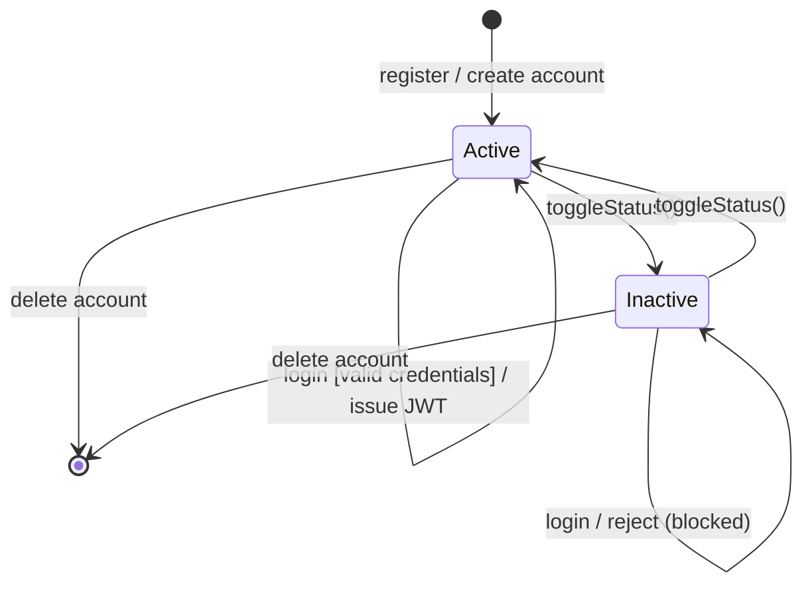
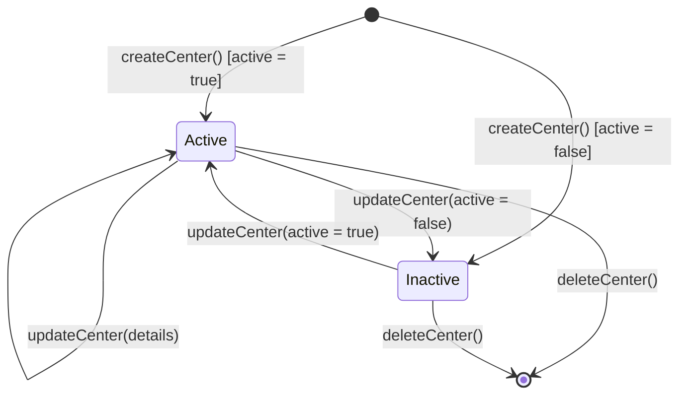
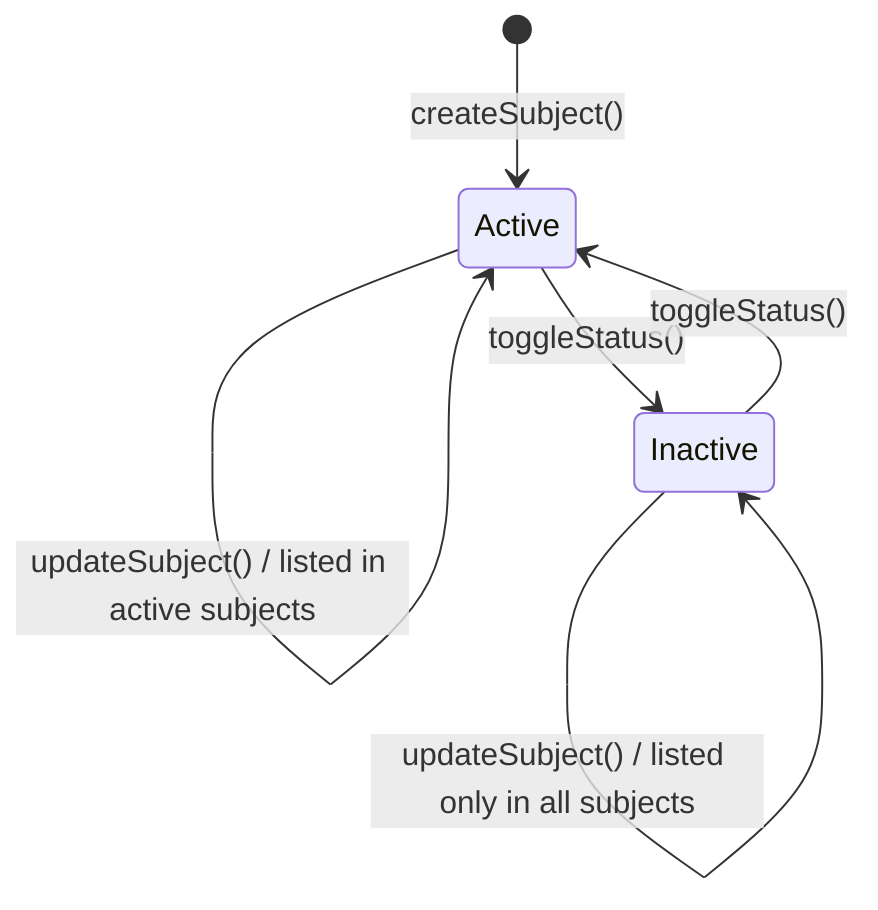
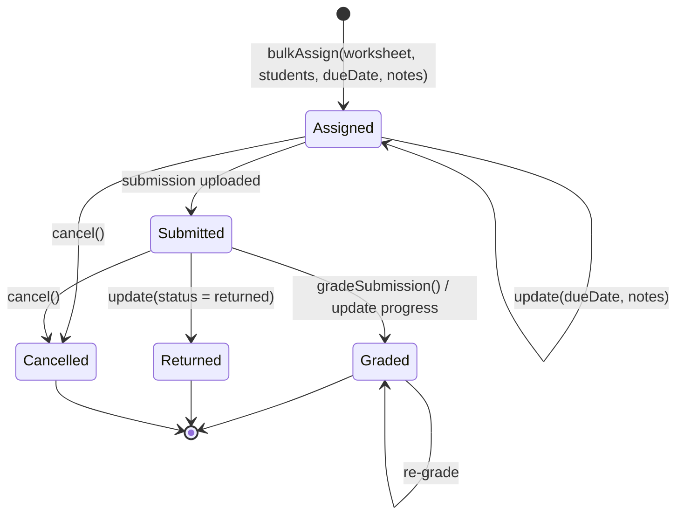
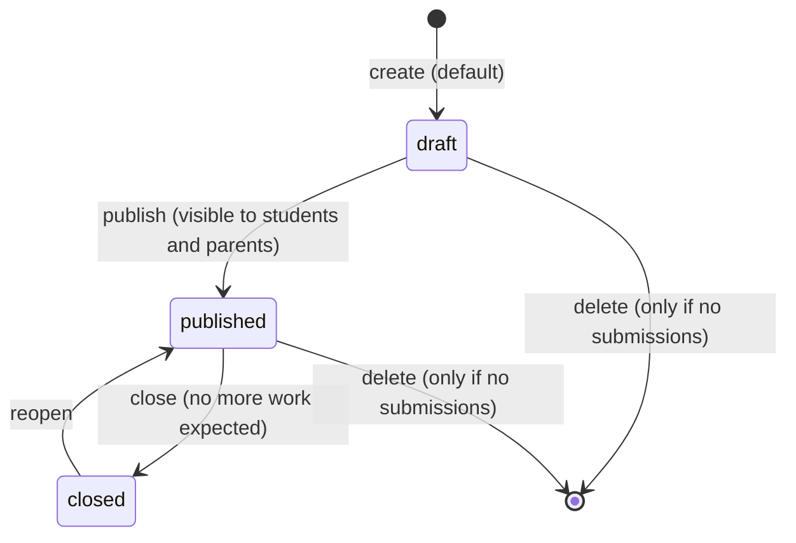
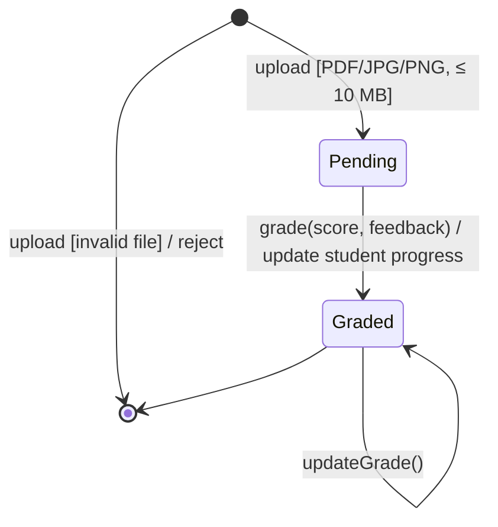
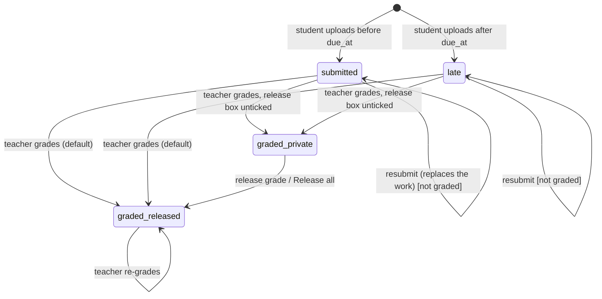
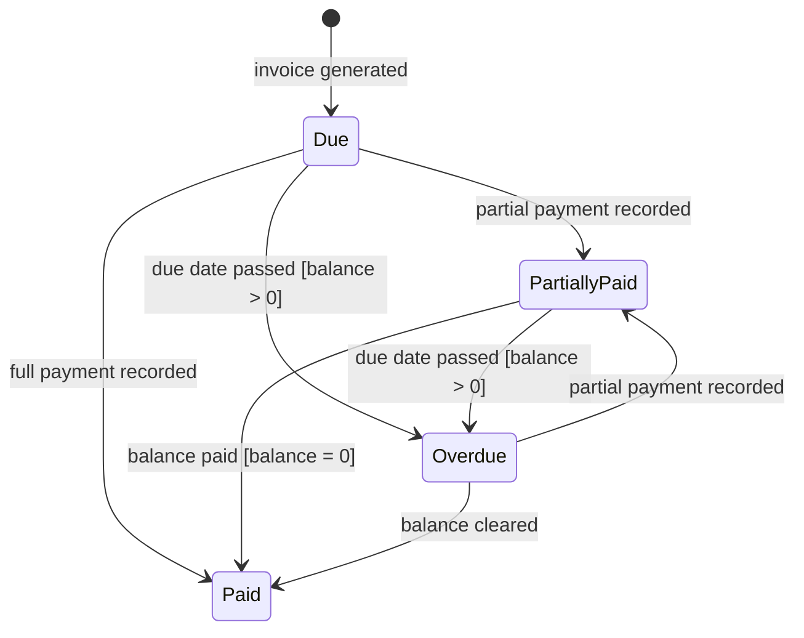
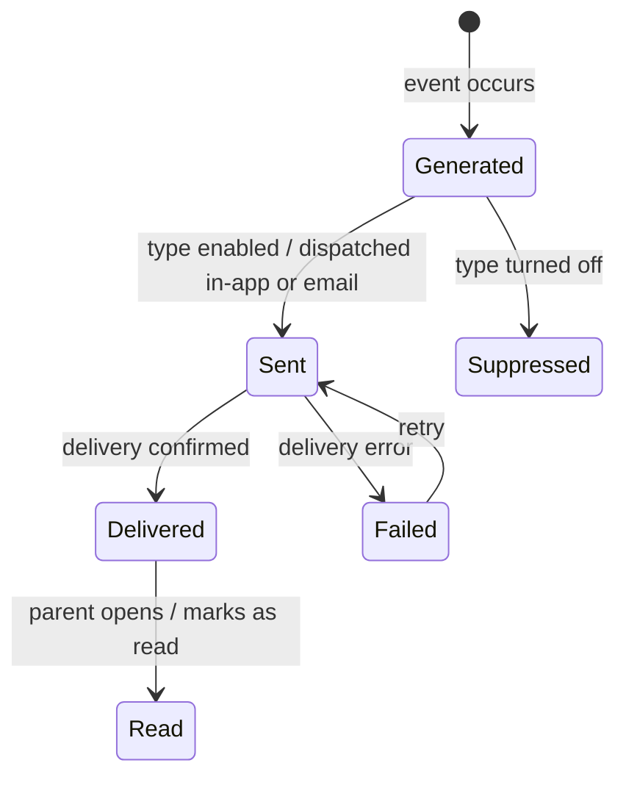

# State Diagrams

A state diagram shows the **life cycle of one object**: the states it can be in and the events that move it.
Source PDFs are in `diagram/state_diagrams/` and `diagram/center_admin/`; they are redrawn here as text diagrams.

| Object | Source PDF | Built? |
|--------|------------|--------|
| User account | [Super Admin: State diagram 1](https://github.com/Nakib00/aspire-system/blob/main/diagram/state_diagrams/super_admin_nakib/State%20diagram%201.pdf) | ✅ |
| Center | same file | ✅ |
| Subject | [State diagram 2](https://github.com/Nakib00/aspire-system/blob/main/diagram/state_diagrams/super_admin_nakib/State%20diagram%202.pdf) | ✅ |
| Assignment, Submission | same file | 🟡 different states in the build |
| Fee | [State diagram 3](https://github.com/Nakib00/aspire-system/blob/main/diagram/state_diagrams/super_admin_nakib/State%20diagram%203.pdf), [Center Admin State Diagram](https://github.com/Nakib00/aspire-system/blob/main/diagram/center_admin/State%20Diagram.pdf) | ⬜ |
| Invoice | [Parent: State Invoice](https://github.com/Nakib00/aspire-system/blob/main/diagram/state_diagrams/parent_farhana/State%20Invoice%20(Parent%20Module)%20.drawio.pdf) | ⬜ |
| Notification | [Parent: State Notification](https://github.com/Nakib00/aspire-system/blob/main/diagram/state_diagrams/parent_farhana/State%20Notification%20(Parent%20Module).drawio.pdf) | ⬜ |

## User account (Super Admin design)

**As built:** `users.active` true/false. An inactive user cannot sign in, and deactivating bumps `token_version`
so existing tokens stop working. Accounts are deactivated, not deleted.

## Center

**As built:** `centers.status` is `active` or `inactive`; there is no delete endpoint (a center with classes cannot be deleted by the database rules).

## Subject

**As built:** `subjects.status` `active`/`inactive`; only active subjects can be chosen for a new class.

## Assignment: design (Super Admin)

### Assignment: as built (Teacher)

Only `published` and `closed` assignments are shown to students. An assignment that already has submissions cannot be deleted.

## Submission: design

### Submission and grade: as built

A parent may submit for a child only while the work is not graded. Families see marks and feedback only in `graded_released`.

## Attendance (as built)

Each record is one of `present`, `late`, `absent`, `excused`, and can be changed by the teacher later.
There is one record per student per class per day.

## Fee (Super Admin and Center Admin design: not built)

```mermaid
stateDiagram-v2
    [*] --> Unpaid: generateMonthlyFees() [active student; no fee for the month]
    Unpaid --> Overdue: markOverdue() [dueDate < today]
    Unpaid --> Paid: pay(method, txnId, paidDate)
    Overdue --> Paid: pay(method, txnId, paidDate)
    Overdue --> Unpaid: edit fee (status = unpaid)
    Paid --> Unpaid: edit fee (status = unpaid)
    Paid --> Overdue: edit fee (status = overdue)
    Paid --> Paid: record payment again / overwrite details
    Unpaid --> Unpaid: updateFee()
    Overdue --> Overdue: updateFee()
```

## Invoice (Parent view: not built)

## Notification (Parent view: not built)

## Drawing a good state diagram

* One diagram = one object. Name the states as **conditions** (Paid), not actions (Pay).
* Label each arrow `event [guard] / action`.
* Every state must be reachable and (unless final) have a way out.
* Add the diagram to this page and keep it in sync with the `status` columns in [Database](Database).
