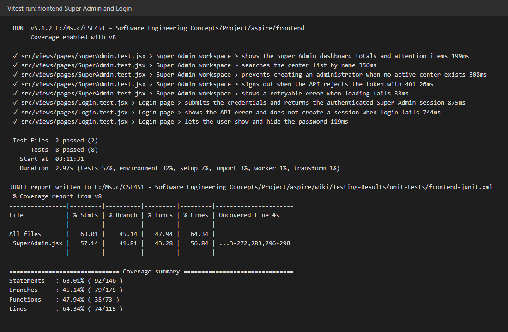
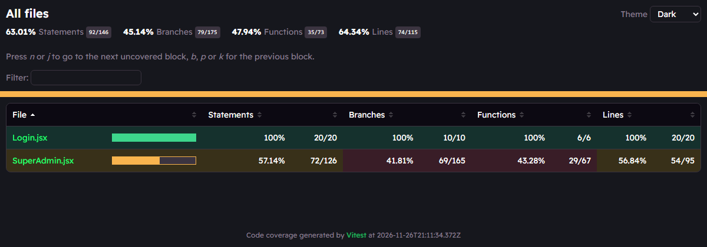
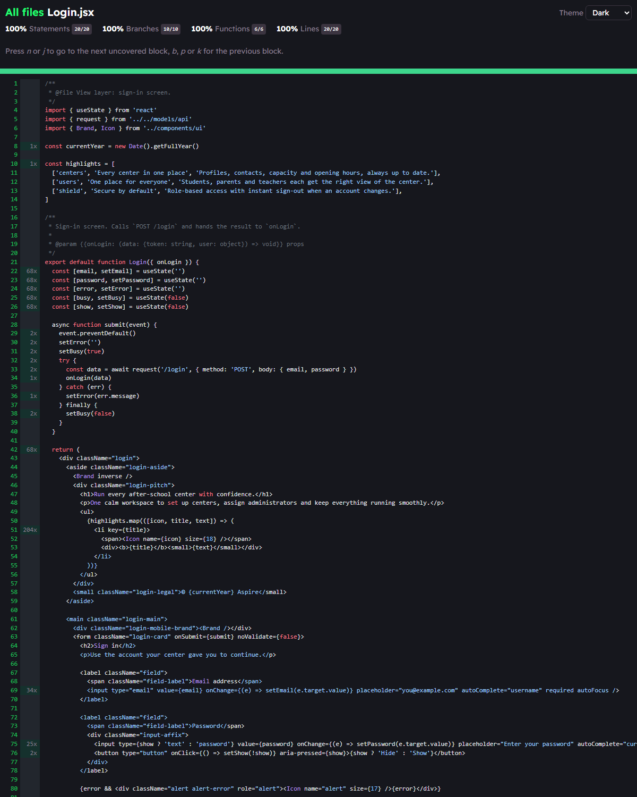
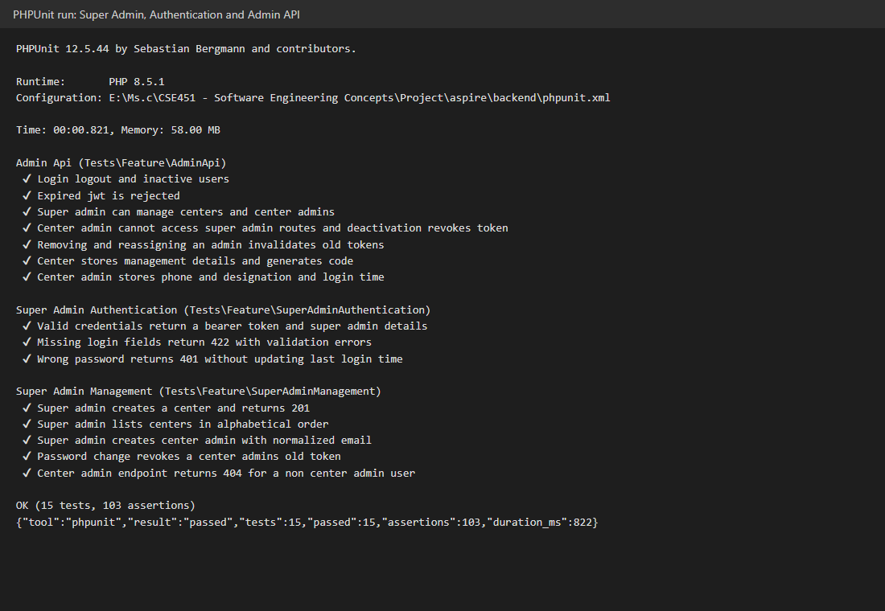
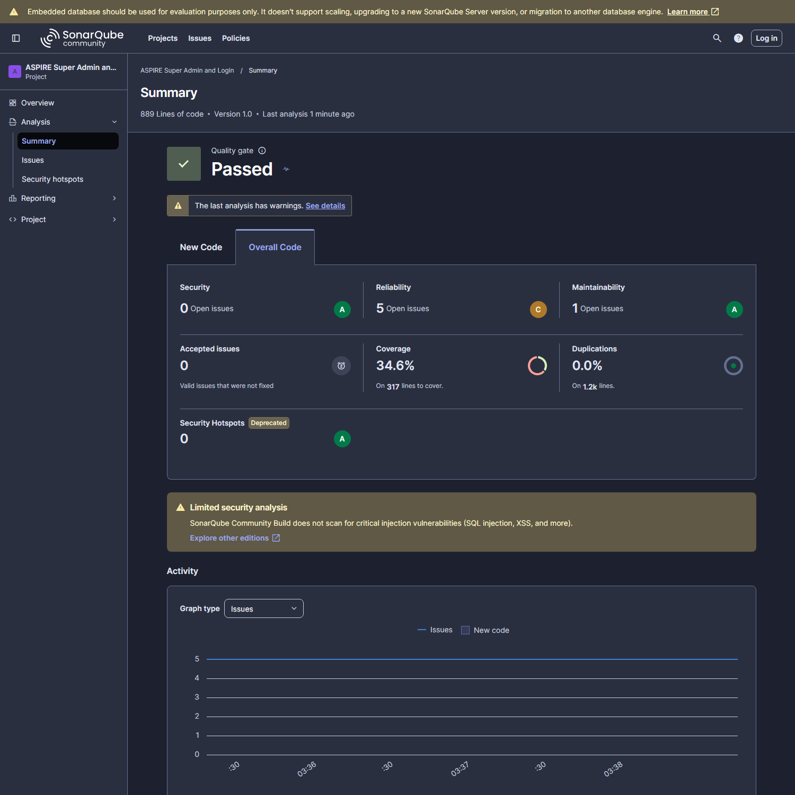
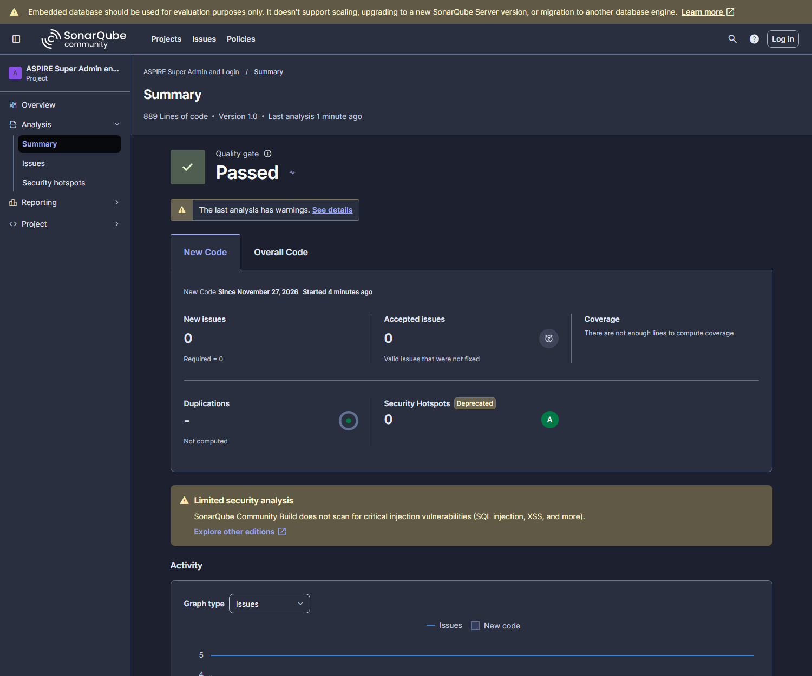
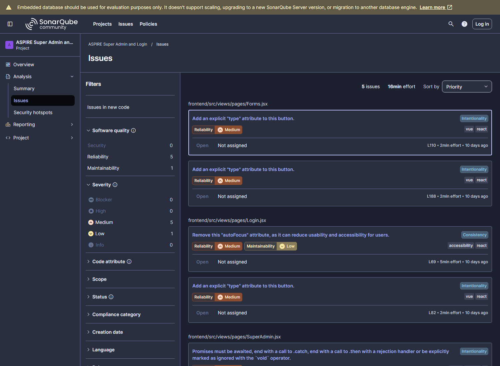
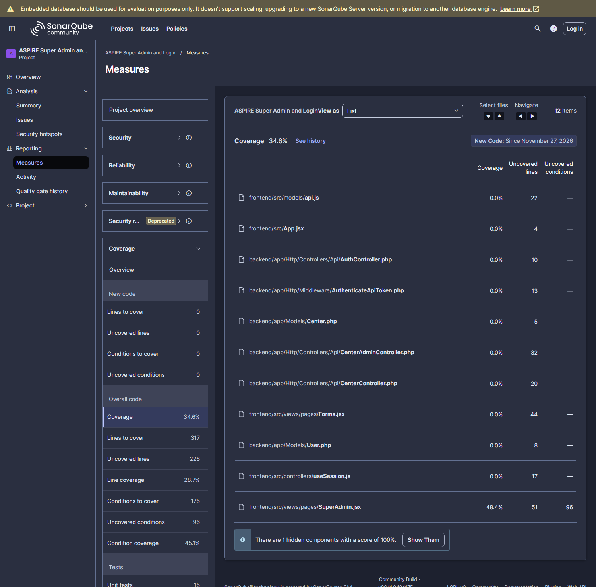
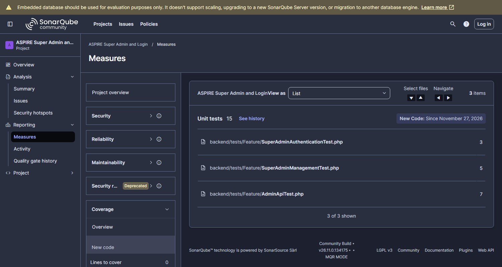

# Test Results: Login and Super Admin

**Run date:** 2026-11-27 · **Branch:** `super-admin-nakib` · **Scope:** the Login screen and the Super Admin
workspace, on the frontend and the backend API.

This page records the latest test and SonarQube run, with screenshots. The raw files (JUnit XML, coverage
report, SonarQube JSON and the scanner log) are in the [`Testing-Results/`](Testing-Results/README.md)
folder. All screenshots in one place: [Test Screenshots](Test-Screenshots). How the tests are written is explained in [Writing Test Cases](Writing-Test-Cases); the overall test
strategy is in [Testing Guide](Testing-Guide).

---

## 1. Summary

| Check | Result |
|-------|--------|
| Frontend unit tests (Vitest) | **8 of 8 passed** (3 Login, 5 Super Admin) in 2.97 s |
| Backend API tests (PHPUnit) | **15 of 15 passed**, 103 assertions, in 0.82 s |
| Frontend coverage (Login and Super Admin only) | **Login.jsx 100%** lines · **SuperAdmin.jsx 56.8%** lines, 41.8% branches |
| SonarQube quality gate | **Passed** (see the caveat in section 5) |
| SonarQube issues | **5 open**: 4 bugs and 1 code smell, **0 vulnerabilities, 0 security hotspots** |
| SonarQube ratings | Security **A** · Reliability **C** · Maintainability **A** |
| SonarQube duplication | **0.0%** |
| SonarQube overall coverage | **34.6%**, but see the limits below: PHP coverage is **not measured** |

**Plain reading of the result:** every test passes. The Login page is fully covered by its tests. The Super
Admin workspace is about half covered. SonarQube found no security problems, and 5 small code-quality issues
that are listed in section 5 and are not fixed by this change.

### Environment

| Item | Version |
|------|---------|
| OS | Windows 11 |
| PHP / Laravel / PHPUnit | 8.5.1 / 13.42.0 / 12.5.44 |
| Node.js | 22.20.0 |
| Vitest / coverage provider | 5.1.2 / v8 (`@vitest/coverage-v8`) |
| React Testing Library / user-event / jsdom | 16.3.3 / 14.6.13 / 29.1.1 |
| SonarQube Community Build | 26.11.0.134175 (run locally at `http://localhost:9000`) |
| SonarScanner CLI / JavaScript analyzer | 8.5.0.16571 / 14.3.0.46350 |
| Java used by the SonarQube server | JDK 21 (SonarQube 26.x does not start on Java 17) |

---

## 2. Frontend unit tests (Vitest and React Testing Library)

Command (from `frontend/`): `npx vitest run --reporter=verbose --coverage`



| # | File | Test | Time | Result |
|--:|------|------|-----:|:------:|
| 1 | `Login.test.jsx` | Submits the credentials and returns the authenticated Super Admin session | 875 ms | Pass |
| 2 | `Login.test.jsx` | Shows the API error and does not create a session when login fails | 744 ms | Pass |
| 3 | `Login.test.jsx` | Lets the user show and hide the password | 119 ms | Pass |
| 4 | `SuperAdmin.test.jsx` | Shows the Super Admin dashboard totals and attention items | 199 ms | Pass |
| 5 | `SuperAdmin.test.jsx` | Searches the center list by name | 356 ms | Pass |
| 6 | `SuperAdmin.test.jsx` | Prevents creating an administrator when no active center exists | 308 ms | Pass |
| 7 | `SuperAdmin.test.jsx` | Signs out when the API rejects the token with 401 | 26 ms | Pass |
| 8 | `SuperAdmin.test.jsx` | Shows a retryable error when loading fails | 33 ms | Pass |

Raw result: [`unit-tests/frontend-junit.xml`](Testing-Results/unit-tests/frontend-junit.xml) and
[`unit-tests/frontend-vitest-output.txt`](Testing-Results/unit-tests/frontend-vitest-output.txt).

### What these tests prove

* **Login:** the form sends the typed email and password to `POST /login`; a successful reply is handed to
  the app as the session; a failed reply shows the server's message in an alert, creates **no** session and
  leaves the button usable; the Show/Hide control toggles the password field.
* **Super Admin:** the dashboard totals (centers, administrators, capacity) and the "needs attention" list are
  correct; searching filters the centers table; an administrator cannot be created without an active center;
  an expired token (`401`) signs the user out; a loading failure shows an error with **Try again**.

### Coverage



| File | Statements | Branches | Functions | Lines |
|------|-----------:|---------:|----------:|------:|
| `Login.jsx` | 100% (20/20) | 100% (10/10) | 100% (6/6) | **100%** (20/20) |
| `SuperAdmin.jsx` | 57.14% (72/126) | 41.81% (69/165) | 43.28% (29/67) | **56.84%** (54/95) |
| Both files | 63.01% (92/146) | 45.14% (79/175) | 47.94% (35/73) | 64.34% (74/115) |

The terminal table shows only `SuperAdmin.jsx`: Vitest hides files that are already at 100%.
The full report is in [`coverage/index.html`](Testing-Results/coverage/index.html); the per-line view of the
Login page is below.



**What is not covered in `SuperAdmin.jsx`** (the uncovered lines, for example 253-257 and 260-272):
saving a new or edited center or administrator, the unassign and activate or deactivate confirmations,
the center detail dialog, and several form-field branches. These are the next tests to write.

---

## 3. Backend API tests (PHPUnit)

Command (from `backend/`): `php vendor/bin/phpunit --testdox tests/Feature/SuperAdminAuthenticationTest.php tests/Feature/SuperAdminManagementTest.php tests/Feature/AdminApiTest.php`



| Test class | Tests | Assertions | What is proven |
|------------|------:|-----------:|----------------|
| `SuperAdminAuthenticationTest` | 3 | 17 | Valid login returns a Bearer JWT and Super Admin details (email is case-insensitive, `last_login_at` is recorded); missing fields give `422`; a wrong password gives `401` and records no login |
| `SuperAdminManagementTest` | 5 | 26 | Center creation returns `201` and a generated code; centers list alphabetically; a Center Admin is created with a normalized email; a password change revokes the old token; a non-Center-Admin record returns `404` |
| `AdminApiTest` | 7 | 60 | Login, logout and inactive users; expired JWT rejected; Super Admin center and admin management; a Center Admin cannot reach Super Admin routes; deactivation, removal and reassignment revoke old tokens |
| **Total** | **15** | **103** | All passed, 0 failures, 0 errors, 0 skipped |

Raw result: [`unit-tests/backend-junit.xml`](Testing-Results/unit-tests/backend-junit.xml) and
[`unit-tests/backend-phpunit-output.txt`](Testing-Results/unit-tests/backend-phpunit-output.txt).

> **PHP line coverage was not measured.** This machine has neither Xdebug nor PCOV, so there is no PHP
> coverage figure. The backend tests do exercise these controllers, but SonarQube cannot see it (see section 5).

---

## 4. How the SonarQube scan was run

1. `frontend/coverage/lcov.info` was produced by the Vitest run above.
2. The PHPUnit JUnit file was written to `wiki/Testing-Results/unit-tests/backend-junit.xml`.
3. The SonarQube server was started locally. Its data directory had to be on a drive with at least 10%
   free space (it refuses to start otherwise), so it was placed on `D:`.
4. `sonar-scanner` was run from the repository root. It reads [`sonar-project.properties`](../sonar-project.properties):
   project key `aspire-super-admin-login`, the Login and Super Admin source files, their tests, the lcov path
   and the PHPUnit report path.

Scope: 12 source files and 5 test files (the Login and Super Admin screens, their API client, the auth and
center controllers, the token middleware and the `User` and `Center` models). Full scanner log:
[`sonarqube/scanner-output.txt`](Testing-Results/sonarqube/scanner-output.txt).

---

## 5. SonarQube results

### Dashboard (overall code)



| Measure | Value |
|---------|------:|
| Quality gate | **Passed** |
| Lines of code (non-comment) | 889 (1,225 lines, 12 files) |
| Bugs / vulnerabilities / code smells | 4 / 0 / 1 |
| Security hotspots | 0 |
| Reliability / Security / Maintainability rating | C / A / A |
| Technical debt | 5 min |
| Duplicated lines | 0.0% |
| Coverage (overall) | 34.6% (lines 28.7%, branches 45.1%) on 317 lines to cover |
| Cyclomatic / cognitive complexity | 322 / 163 |
| Tests imported | 15 (PHPUnit), 0 failures, 0 errors, 0 skipped |

> **How to read "Passed".** This was the first analysis, so the gate's only condition ("no new issues in new
> code") has nothing to compare against and passes. It does **not** say the code has no issues. The real
> picture is in the **Overall Code** tab above and in the issue list below.



### Issues found (5)



| # | File and line | Rule | Type | Meaning | Suggested fix |
|--:|---------------|------|------|---------|---------------|
| 1 | `Login.jsx:82` | S9011 | Bug (Medium) | The **Sign in** button has no explicit `type`. In a form the default is `submit`, so it behaves correctly today | Add `type="submit"` |
| 2 | `Login.jsx:69` | S9379 | Code smell | `autoFocus` on the email field can hurt usability and accessibility | Remove `autoFocus` or move focus on purpose |
| 3 | `SuperAdmin.jsx:248` | S9383 | Bug (Medium) | `Promise.resolve().then(refresh)` has no `.catch` or `void`. `refresh` already catches its own errors, so this is low risk | Write `void refresh()` or handle the rejection |
| 4 | `Forms.jsx:110` | S9011 | Bug (Medium) | Button without an explicit `type` | Add `type="button"` or `type="submit"` |
| 5 | `Forms.jsx:188` | S9011 | Bug (Medium) | Same as above | Same fix |

**None of these is a security problem** and none was fixed by this change: the task was to test and record.
Items 1 to 3 are one-line fixes in the Login and Super Admin files and are good first tasks.

### Coverage by file (as SonarQube sees it)



| File | Lines of code | Coverage | Why |
|------|--------------:|---------:|-----|
| `frontend/src/views/pages/Login.jsx` | 75 | **100%** | Fully covered by `Login.test.jsx` |
| `frontend/src/views/pages/SuperAdmin.jsx` | 254 | **48.4%** | Partly covered (see section 2) |
| `frontend/src/views/pages/Forms.jsx` | 172 | 0% | Reached only when a form dialog opens; no test opens one yet |
| `frontend/src/models/api.js` | 38 | 0% | Mocked in the page tests, so never run for real |
| `frontend/src/App.jsx`, `frontend/src/controllers/useSession.js` | 21, 30 | 0% | No test yet |
| `backend/app/...` (3 controllers, 1 middleware, 2 models) | 299 | 0% | **No PHP coverage report was supplied.** PHPUnit exercises these files, but there is no driver to measure it |

So the **34.6% overall** figure is a floor and is dominated by the missing PHP report. Treat the
**Login 100%** and **Super Admin 48.4%** figures as the reliable ones.



### Scan warnings and limits

* **Missing blame information for 2 files**: `Login.test.jsx` and `SuperAdmin.test.jsx` are not committed yet,
  so Git has no author data for them. It clears after they are committed.
* SonarQube **Community Build** does not run the deep injection analysis (SQL injection, XSS). "0
  vulnerabilities" means none were found by the checks that Community Build has.
* The analysis scope is only the Login and Super Admin files, set by `sonar.inclusions`. Other roles are not scanned.

---

## 6. Recommended next steps

1. Fix the three one-line issues in `Login.jsx` and `SuperAdmin.jsx` (table above), then rerun the scan.
2. Write tests for `SuperAdmin.jsx` saving and the confirmation dialogs (lines 252-274) to lift coverage.
3. Install **PCOV** (or Xdebug), run PHPUnit with `--coverage-clover`, and add
   `sonar.php.coverage.reportPaths` so SonarQube reports the real backend coverage.
4. Add a test that exercises `models/api.js` against a mocked `fetch`.
5. Run the scan in CI so the "new code" gate becomes meaningful on every pull request.

---

## 7. How to reproduce this run

```bash
# 1. Frontend tests, JUnit file and coverage (from frontend/)
npx vitest run --reporter=verbose --reporter=junit \
  --outputFile.junit=../wiki/Testing-Results/unit-tests/frontend-junit.xml --coverage

# 2. Backend tests and JUnit file (from backend/)
php vendor/bin/phpunit --log-junit ../wiki/Testing-Results/unit-tests/backend-junit.xml --testdox \
  tests/Feature/SuperAdminAuthenticationTest.php tests/Feature/SuperAdminManagementTest.php tests/Feature/AdminApiTest.php

# 3. SonarQube scan (from the repository root; server running, JDK 17+ for the scanner)
sonar-scanner -Dsonar.host.url=http://localhost:9000 -Dsonar.token=<your-token>
```

SonarQube server notes (Windows): download the Community Build zip, run it with **JDK 21**, and keep
`sonar.path.data` on a drive with at least 10% free space. Create the token in **My Account → Security**.
**Never commit the token**; pass it on the command line or in an environment variable.
Open `http://localhost:9000/dashboard?id=aspire-super-admin-login` to see the project.

Related: [Writing Test Cases](Writing-Test-Cases) · [Testing Guide](Testing-Guide) ·
[Authentication and Roles](Authentication-and-Roles)
