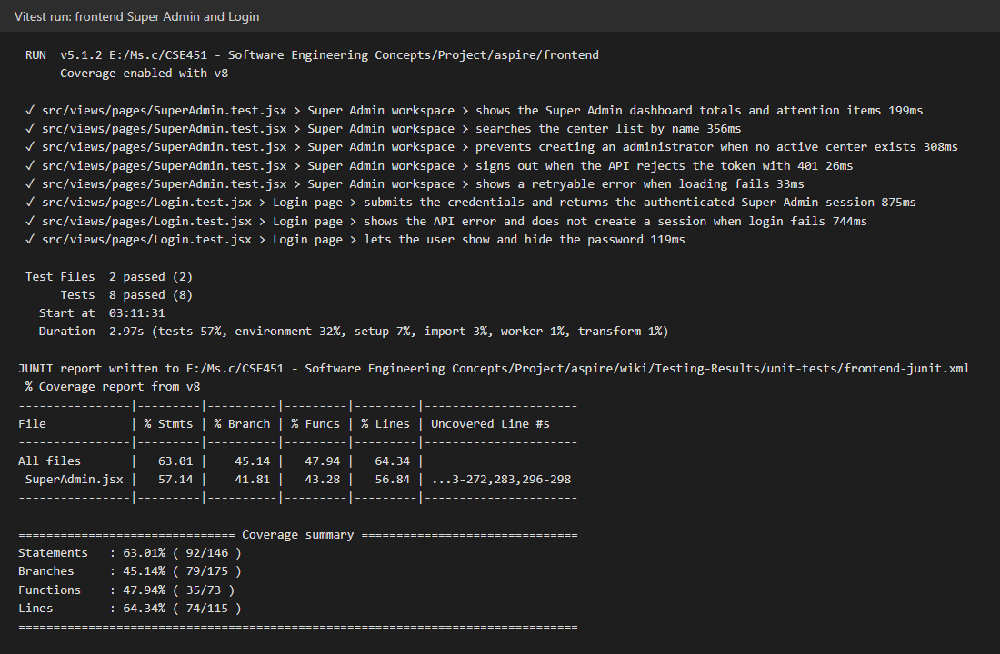
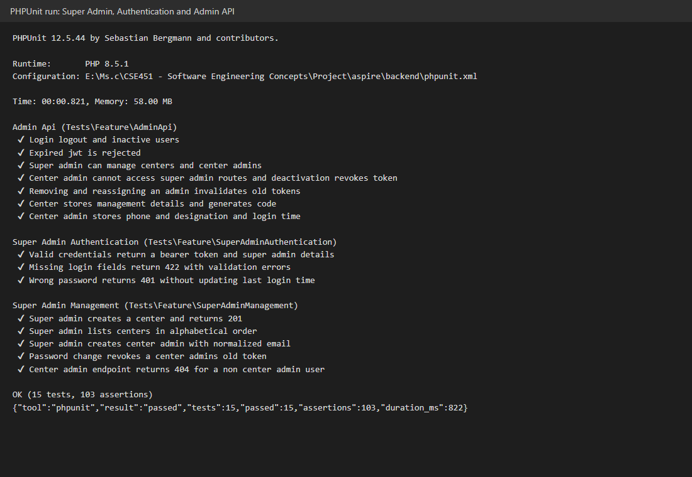
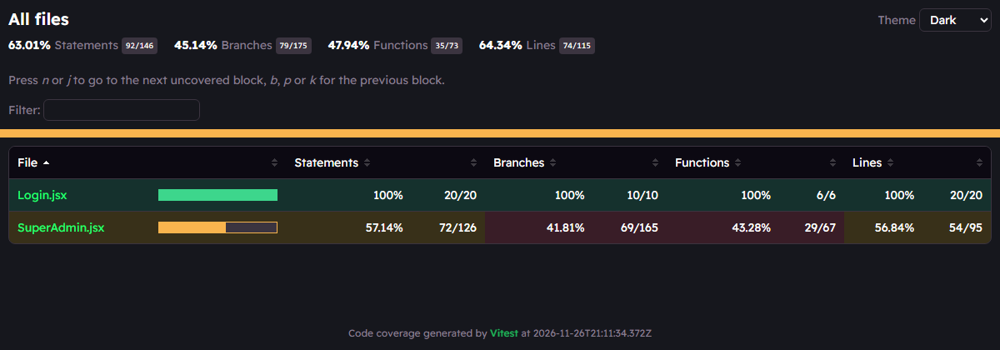
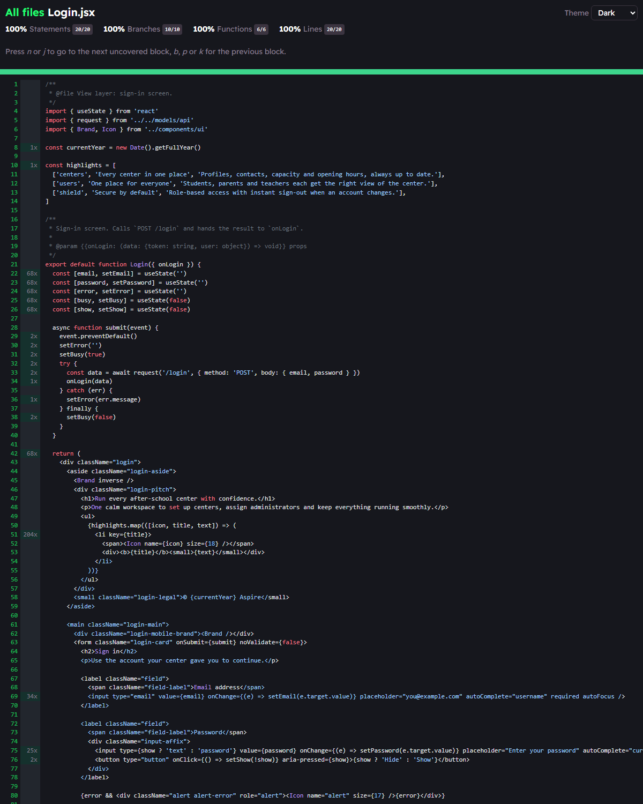
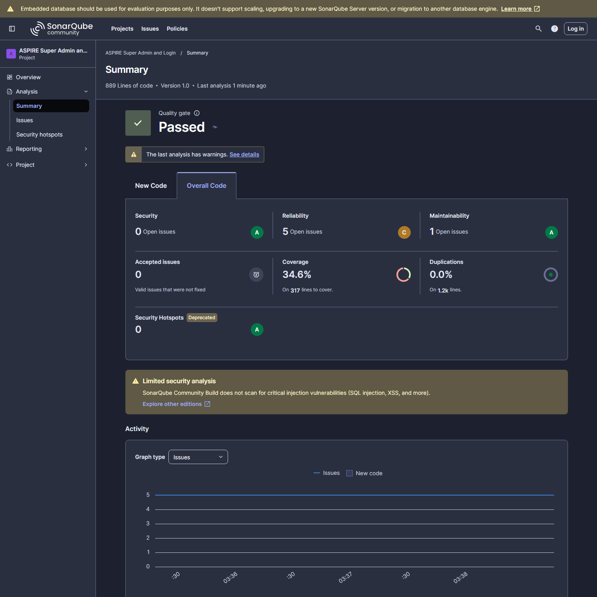
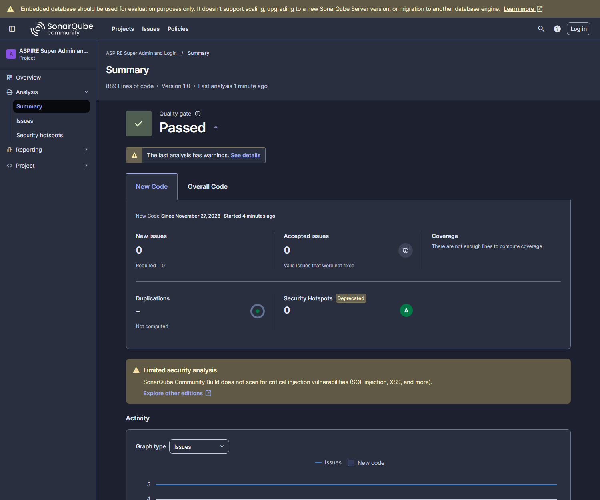
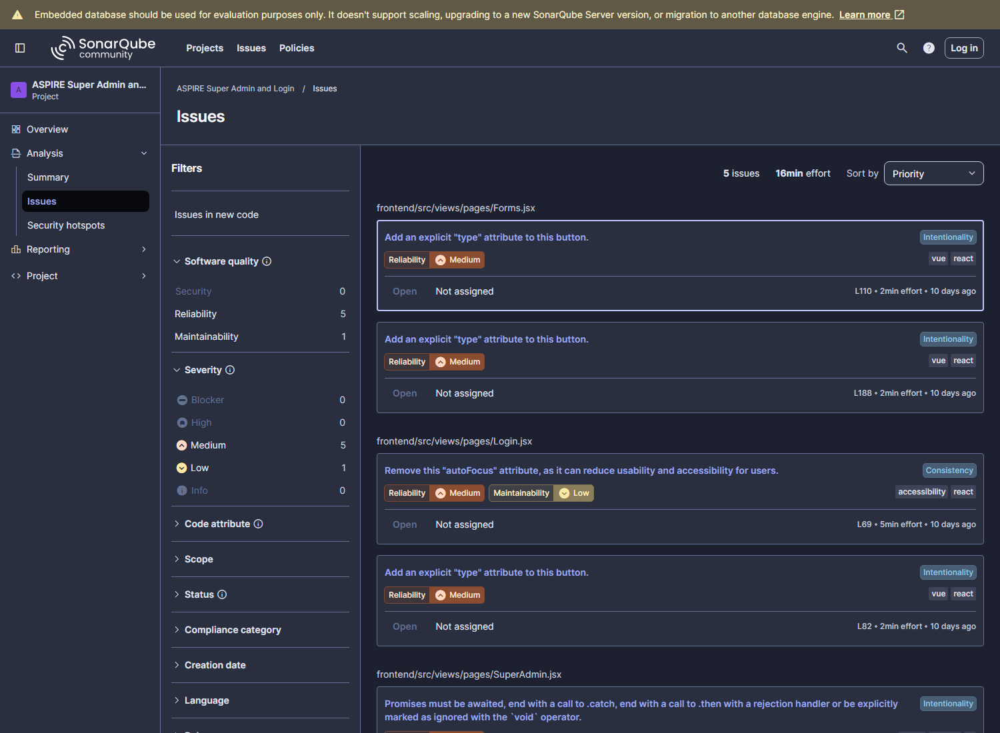
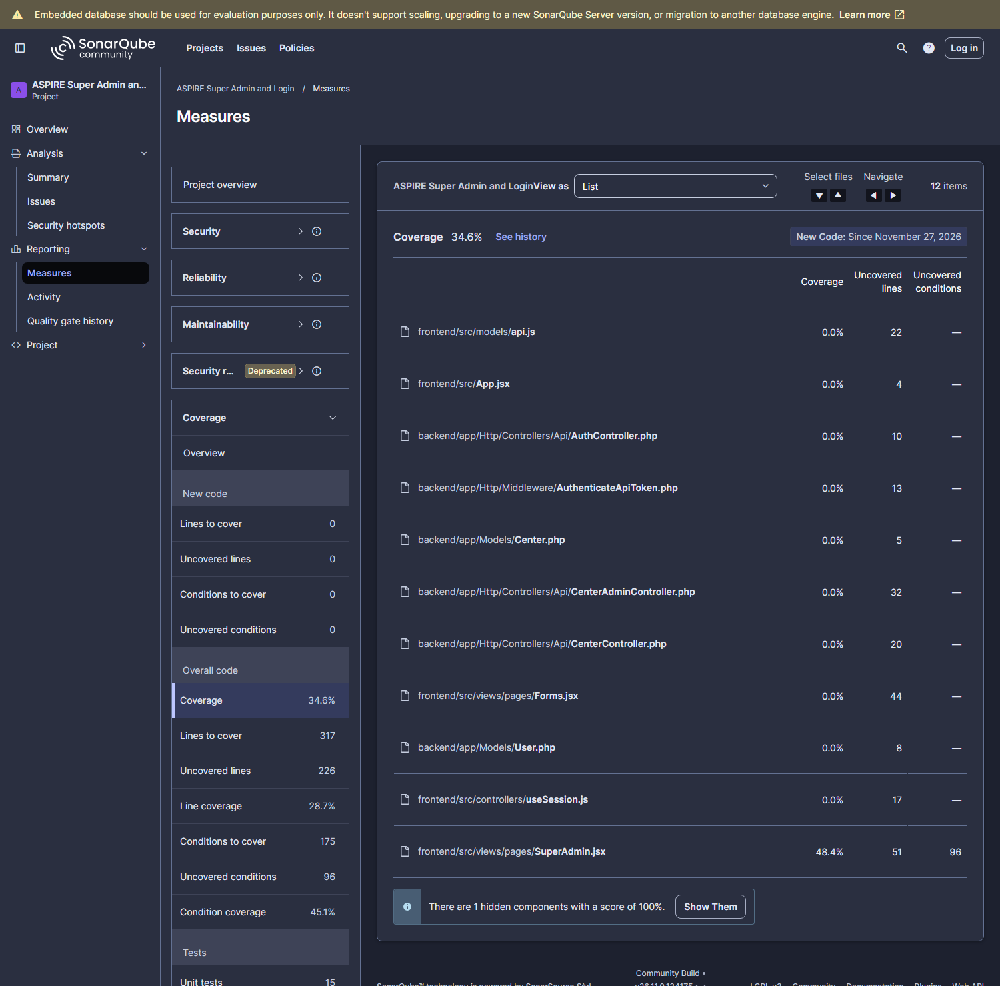
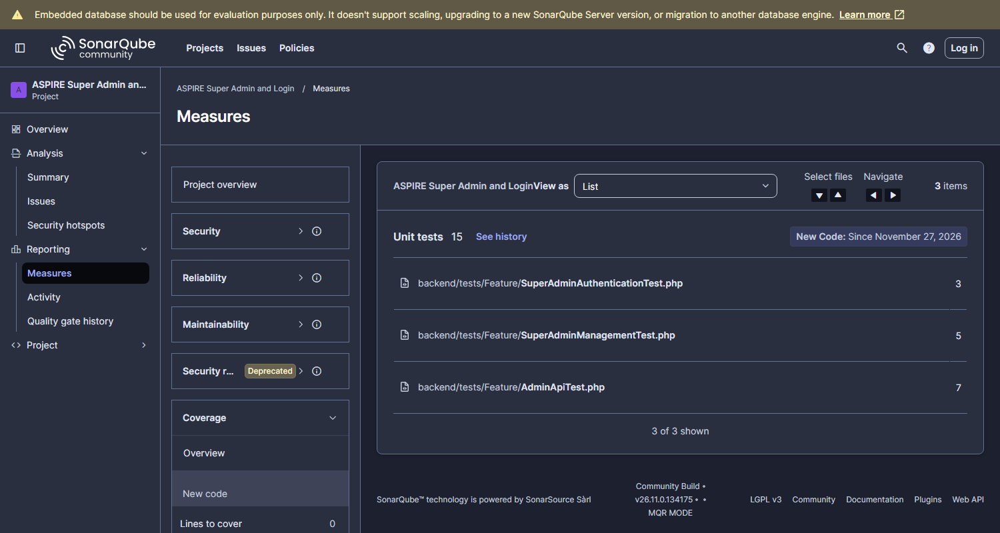

# Test Screenshots: Login and Super Admin

Screenshots from the 2026-11-27 run. Numbers and explanation: [Test Results](Test-Results).
Raw files: `wiki/Testing-Results/`.

## 1. Unit tests

### Frontend (Vitest): 8 of 8 passed

### Backend (PHPUnit): 15 of 15 passed, 103 assertions

## 2. Coverage report

### Summary: Login.jsx 100%, SuperAdmin.jsx 56.84% lines

### Login.jsx line by line

## 3. SonarQube

### Dashboard, Overall Code tab: gate passed, coverage 34.6%, Reliability C

### Dashboard, New Code tab (first analysis, so nothing to compare)

### Issues: 5 open (4 bugs, 1 code smell)

### Coverage by file

### Test measures (15 tests imported)

