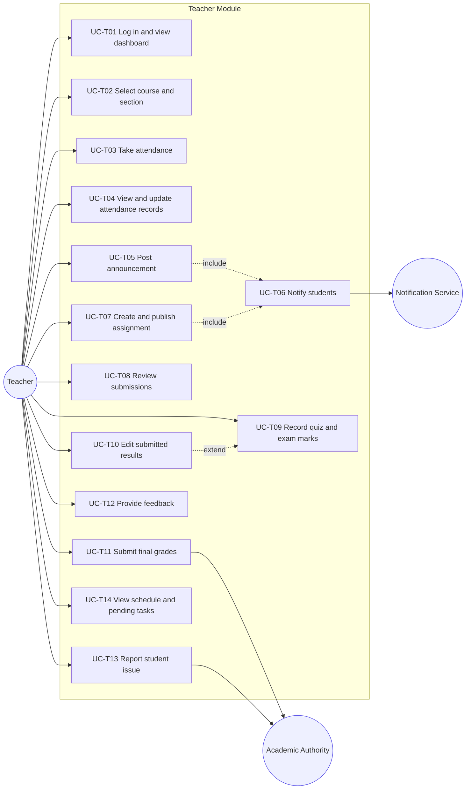
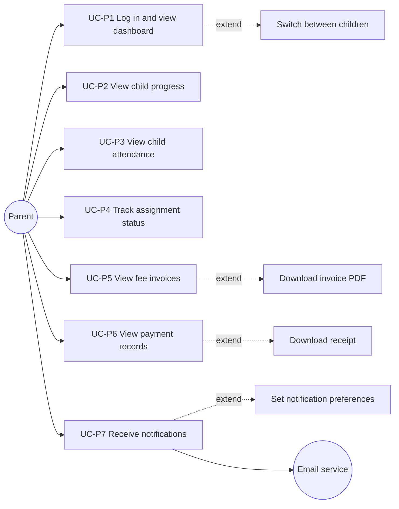

# Use Cases

A use case describes **one goal an actor achieves with the system**. This page indexes every use case
diagram and narrative the team produced, lists the use cases by module, and says which are implemented.

PDF sources (all in `diagram/` on `main`):

| Module | Diagram | Narratives |
|--------|---------|------------|
| Super Admin | [Figure 1](https://github.com/Nakib00/aspire-system/blob/main/diagram/use_case_diagram/super_admin_nakib/Use%20case%20diagram%20-%20Figure%201.pdf) · [2](https://github.com/Nakib00/aspire-system/blob/main/diagram/use_case_diagram/super_admin_nakib/Use%20case%20diagram%20-%20Figure%202.pdf) · [3](https://github.com/Nakib00/aspire-system/blob/main/diagram/use_case_diagram/super_admin_nakib/Use%20case%20diagram%20-%20Figure%203.pdf) · [4](https://github.com/Nakib00/aspire-system/blob/main/diagram/use_case_diagram/super_admin_nakib/Use%20case%20diagram%20-%20Figure%204.pdf) · [5](https://github.com/Nakib00/aspire-system/blob/main/diagram/use_case_diagram/super_admin_nakib/Use%20case%20diagram%20-%20Figure%205.pdf) | not yet written |
| Center Admin | [Use Case Diagram](https://github.com/Nakib00/aspire-system/blob/main/diagram/center_admin/Use%20Case%20Diagram.pdf) (includes catalogue) | catalogue inside the diagram PDF |
| Teacher | [Teacher module diagram](https://github.com/Nakib00/aspire-system/blob/main/diagram/use_case_diagram/teacher_ataur/Teacher_Module_UseCase_Diagram_Ataur.drawio.pdf) | [Teacher narratives](https://github.com/Nakib00/aspire-system/blob/main/diagram/use-case-narratives/teacher_use_case_narratives_ataur.pdf) |
| Parent | [Parent diagram](https://github.com/Nakib00/aspire-system/blob/main/diagram/use_case_diagram/parent_farhana/UseCaseDiagram_Parent_Farhana.drawio.pdf) | [Parent narratives](https://github.com/Nakib00/aspire-system/blob/main/diagram/use-case-narratives/UseCaseNarratives%20(Parent%20Module).pdf) |

Legend: ✅ built · 🟡 partly · ⬜ designed only. See [Implementation Status](Implementation-Status).

---

## Teacher (UC-T01 … UC-T14)

Actors: **Teacher** (primary); Student, Academic Authority, System Administrator, Notification Service (secondary).

| ID | Use case | Story | Requirements | Status | Where in code |
|----|----------|-------|--------------|--------|---------------|
| UC-T01 | Log in and view dashboard | US-T1 | FR-01, 02 | ✅ | `AuthController`, `Teacher/DashboardController`, `Login.jsx`, `Teacher.jsx` |
| UC-T02 | Select course and section | US-T2 | FR-03, 04 | ✅ | `Teacher/ClassController`, `TeacherScopedController::myClass` |
| UC-T03 | Take attendance | US-T3 | FR-05–07 | ✅ | `Teacher/AttendanceController`, `Attendance.jsx` |
| UC-T04 | View and update attendance records | US-T4 | FR-08, 09 | ✅ | `AttendanceController::report` |
| UC-T05 | Post announcement | US-T5 | FR-10, 11 | ✅ | `Teacher/AnnouncementController`, `Announcements.jsx` |
| UC-T06 | Notify students | US-T6 | FR-12, 13 | ⬜ | n/a |
| UC-T07 | Create and publish assignment | US-T7 | FR-14, 15 | ✅ | `Teacher/AssignmentController`, `Assignments.jsx` |
| UC-T08 | Review submissions | US-T8 | FR-16–18 | ✅ | `Teacher/SubmissionController`, `ReviewPage` |
| UC-T09 | Record quiz and exam marks | US-T9 | FR-19, 20 | 🟡 | assignment grading only |
| UC-T10 | Edit submitted results | US-T10 | FR-21, 22 | 🟡 | `SubmissionController::grade` replaces a grade |
| UC-T11 | Submit final grades | US-T11 | FR-23, 24 | ⬜ | n/a |
| UC-T12 | Provide feedback | US-T12 | FR-25, 26 | ✅ | `grades.feedback` |
| UC-T13 | Report student issue | US-T13 | FR-27, 28 | ⬜ | n/a |
| UC-T14 | View schedule and pending tasks | US-T14 | FR-29, 30 | ✅ | `Teacher/DashboardController` |

**Example narrative: UC-T03 Take attendance**

| | |
|-|-|
| Primary actor | Teacher |
| Precondition | UC-T01 and UC-T02 done; the class is assigned to the teacher |
| Main flow | 1. Teacher opens *Attendance* and picks a class and date. 2. System lists enrolled students with any existing marks. 3. Teacher marks each student present / late / absent / excused (optional note). 4. Teacher saves. 5. System stores one record per student for that day and confirms. |
| Alternate flow | The day already has records → they are updated, not duplicated. |
| Exception | Class not assigned to the teacher → not found (404). Invalid status → validation error (422). |
| Postcondition | Attendance recorded; visible to parents/students in their portals. |

The full narratives for all 14 teacher use cases are in the PDF linked above.

---

## Parent (UC-P1 … UC-P7)

| ID | Use case | Status | Where in code |
|----|----------|--------|---------------|
| UC-P1 | Log in and view dashboard (switch children) | ✅ | `PortalController::parent`, `Portals.jsx` |
| UC-P2 | View child progress | ✅ | released grades via `childAssignments` |
| UC-P3 | View child attendance | ✅ | `parent` payload `attendance` |
| UC-P4 | Track assignment status | ✅ | `PortalController::childAssignments` |
| UC-P5 | View fee invoices (+ PDF) | ⬜ | tables only |
| UC-P6 | View payment records (+ receipt) | ⬜ | tables only |
| UC-P7 | Receive notifications (+ preferences, e-mail) | ⬜ | n/a |

Common rule from the narratives: every use case except UC-P1 requires a logged-in parent, and the system checks the child belongs to that parent.

---

## Center Admin (UC-CA-01 … UC-CA-13)

Included use cases: *Check active students and existing student-month fees* (by UC-CA-09), *Validate and save payment details* (by UC-CA-11).

| ID | Use case | Status |
|----|----------|--------|
| UC-CA-01 | Log in and manage own account | 🟡 login ✅, profile edit ⬜ |
| UC-CA-02 | View assigned-center dashboard | ✅ |
| UC-CA-03 | Manage student, teacher and parent accounts | ✅ |
| UC-CA-04 | Link parent and allocate teacher | ✅ (guardians ✅; teacher via class assignment) |
| UC-CA-05 | Enroll student and update enrolment status | ✅ |
| UC-CA-06 | View student learning and fee details | 🟡 profile ✅, fees ⬜ |
| UC-CA-07 | Monitor attendance history and totals | ⬜ (teacher side built) |
| UC-CA-08 | Mark and correct attendance | ⬜ (teacher side built) |
| UC-CA-09 | Generate monthly fees | ⬜ |
| UC-CA-10 | View and correct fee records | ⬜ |
| UC-CA-11 | Record full fee payment | ⬜ |
| UC-CA-12 | Mark and view overdue fees | ⬜ |
| UC-CA-13 | View center and student reports | ⬜ |

---

## Super Admin (UC-SA-01 … UC-SA-66)

Included use cases: *Verify account status* (UC-SA-I1), *Create user account* (I2), *Generate enrolment number* (I3), *Validate uploaded file* (I4), *Update student progress* (I5).

| Figure | IDs | Group | Status |
|--------|-----|-------|--------|
| 1 | UC-SA-01…14 | Accounts, users and centers: register, login, logout, profile, change password, toggle user status, view/delete center admins, view parents, create/view/update/delete center, center statistics | ✅ login, centers (create/view/update), center admins, status toggle · ⬜ profile, change password, delete, statistics |
| 2 | UC-SA-15…25 | Teachers and students (create, view, update, delete, assign/unassign students to a teacher, view student records) | ➡ implemented for the **Center Admin** role instead |
| 3 | UC-SA-26…38 | Curriculum: subjects, levels, worksheets (upload, browse, update, delete, download) | 🟡 subjects exist per center (Center Admin); levels and worksheets ⬜ |
| 4 | UC-SA-39…50 | Assignments, grading and attendance: bulk assign worksheet, view/update/cancel assignments, upload on behalf of a student, review, grade, re-grade, bulk attendance, edit attendance, monthly summary | ➡ implemented for the **Teacher** role instead |
| 5 | UC-SA-51…66 | Fees, dashboard, reports: generate monthly fees, view/update/mark paid/overdue, collection summary, dashboard, system/center/teacher/student/fee/attendance/level reports | ⬜ |

> **Design vs build.** The original Super Admin design placed day-to-day teaching operations at system level. During
> implementation these were moved to the **Center Admin** and **Teacher** roles so each center is self-managed, and the
> Super Admin became the multi-center owner. The diagrams are kept as the original analysis; this table maps them to the built system.

---

## How to write a new use case

1. Give it an ID (`UC-<role>-<nn>`) and a verb-first name ("Record payment").
2. Name the primary actor and any secondary actors.
3. State **preconditions** and **postconditions**.
4. Write the **main flow** as numbered steps, then **alternate** and **exception** flows.
5. Link the user story and requirements it satisfies; add it to the diagram and to this page.
6. When it is built, add the test name and the controller/screen in the table.
